# Administration guide

For storage administrators: the pages only they see, and what to do with them. Installing Pinax, scanning, the
catalog, upgrades, logs, and monitoring are in [DEPLOYMENT.md](DEPLOYMENT.md); every setting is in
[CONFIGURATION.md](CONFIGURATION.md); every command is in [CLI.md](CLI.md).

A **storage administrator** sees every filesystem and every folder, including folders no lab owns, and the pages
under *Administration* in the sidebar. The first one is made from the command line (`pinax user add --admin`);
after that, administrators make others under *People and access*. At least one active administrator always
remains, and nobody can remove their own role or deactivate themselves.

A new administrator's first week usually goes:

1. Check that every filesystem's latest scan is in (*Scans*), and that automatic ingest is running.
2. Map every top-level folder to its lab or department (*Folders and labs*, *Unmapped only*).
3. Add the people, or import them ([IMPORT.md](IMPORT.md)), and check what each sees (*People and access*).
4. Set each filesystem's capacity (*Capacity*), and its prices and free tiers if storage is charged (*Costs*).
5. Look at *Storage health* for folders the scanner could not read, and give it access.
6. Read *All data* each week: what grew, what needs attention.

## All data

An administrator's home page: every filesystem as of its latest scan. Along the top, the total size and space on
disk, files and folders, how much is unchanged for two years or more, the change since the previous scans, and the
unmapped folders (folders no lab owns, so nobody is charged for them). Each filesystem's card has its size, average
age, data by age, when it was scanned and how long the scan and its index took, any scan errors, and how full it
is, with when it fills at its trend.

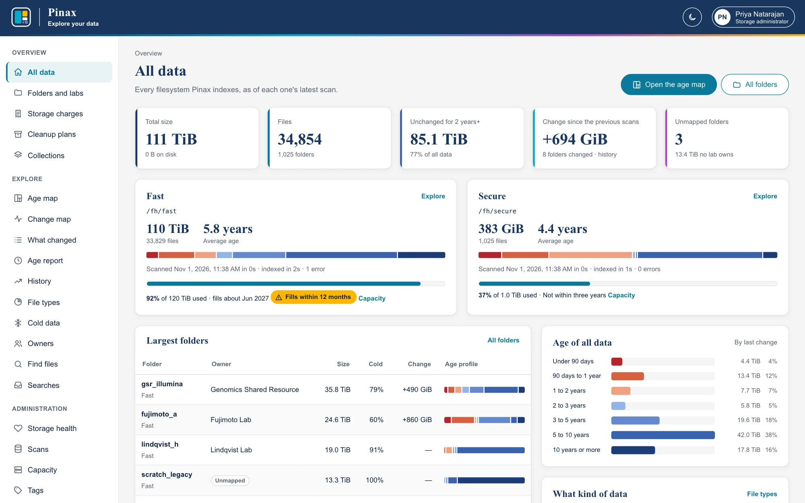

Below: the largest folders, with owner, size, cold share, change, and age profile; the age of all data; what kind
of data it is; **Needs attention** (a filesystem that is full or fills within `PINAX_FILL_WARNING_MONTHS`, the
unmapped folders and what they hold, scan errors, and problem file names, each with a link to it); and **Recent
activity**, the latest changes from the audit log. Failed or skipped scans, and automatic ingest stopping, show on
*Scans*.

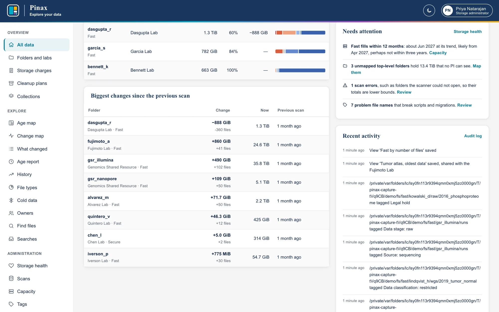

Every report works for a whole filesystem too: the age map of *Fast* shows each top-level folder, unmapped ones
among them, and *History* of a filesystem draws its capacity above the columns.

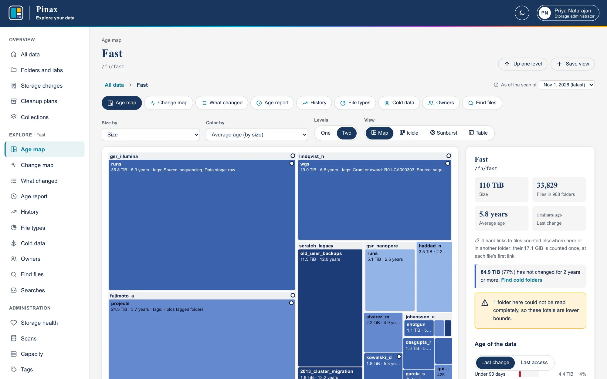

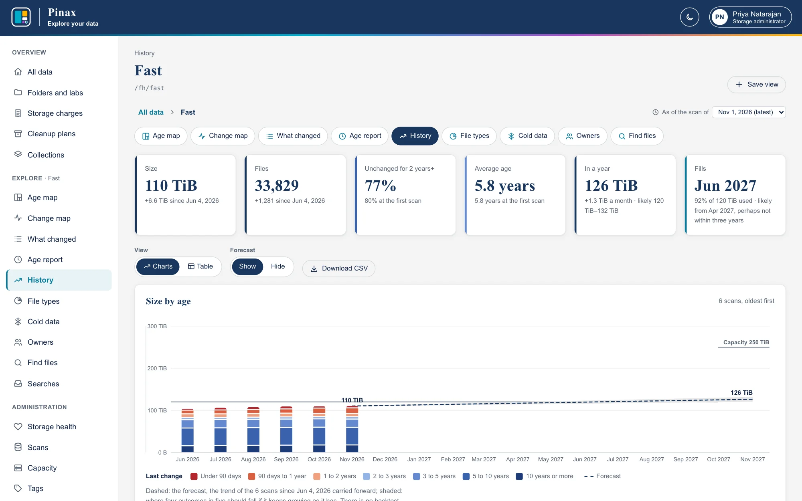

## Folders and labs

Every top-level folder of every filesystem: who owns it, its size, files, cold share, average age, last change,
change since the previous scan, and age profile. *Filesystem*, *Owner*, and *Unmapped only* narrow the list; the
person icon beside an owner changes it.

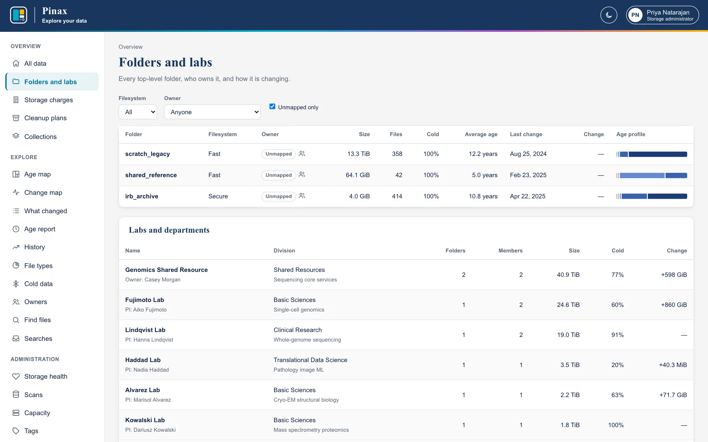

- **Map a folder**: choose its lab or department. Its members see it from then on, and it is charged to its owner
  from the moment it was mapped.
- **Move a folder to another lab**: choose the new owner. The old lab stops seeing it; charges move with it from
  that moment, and earlier months stay as they were.
- **Unmap it**: no lab owns it; only administrators see it, and nobody is charged.

Every change is audited, and Pinax keeps when each folder belonged to whom, for past months' charges. Below the
folders, *Labs and departments* lists each with its owner or PI, division, folders, members, size, cold share, and
change.

For many folders at once, import them from CSV ([IMPORT.md](IMPORT.md)). Until the site chooses an authoritative
source of folder ownership, the import files are how to keep it in step.

## People and access

Who can sign in, what each person sees, and who administers Pinax. *People* lists everyone, with their username,
labs and roles, and status; the tabs narrow it to administrators, people with site roles, people with no access,
and inactive people; *Search* finds by name, username, email, or title.

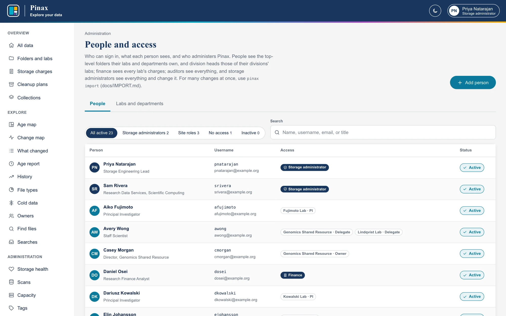

**Add person**: a username (with single sign-on, exactly the name the proxy sends; with Entra ID, usually the user
principal name), a name, an email, a title, and a lab with a role. The panel shows the folders they will see before
you save. A person's page has their profile, their labs and roles, the administrator role, and their recent
changes from the audit log:

- **Labs**: add them to a lab or department as PI (or owner) or delegate, change the role, or take them out.
- **Site roles**: storage administrator, auditor, finance, or head of one or more divisions, beside any labs
  ([Site roles](#site-roles)).
- **Deactivate**: they cannot sign in, and their memberships and role are kept, unused, until *Reactivate*; their
  sessions end and their API tokens are revoked.
- **API tokens**: theirs, with when each was last used, to revoke ([API tokens](#api-tokens)).
- **Set a new temporary password** (local sign-in): Pinax shows it once; they must change it when they next sign
  in. It also unlocks a locked account and ends their sessions.

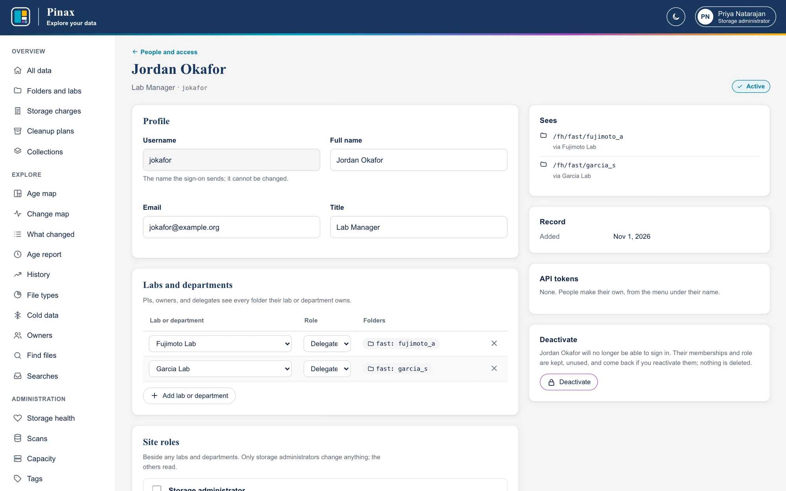

### Site roles

Beside lab memberships, a person can have site roles, given and taken away on their page, each change audited. A
person can have several (a finance officer who is also a PI), and every role works with every way of signing in.

| Role | Sees | Changes |
| --- | --- | --- |
| Storage administrator | Everything | Everything: people, labs, folder ownership, prices, capacity, the tags, and any lab's tags and plan |
| Auditor | Everything a storage administrator sees, people and the audit log included | Nothing |
| Finance | Every lab's and department's charges (*Storage charges* of any of them, *Chargeback* and its statement), and the prices, free tiers, and capacities behind them | Nothing; sees no folders, files, or people |
| Division head | Each lab in the divisions chosen (a lab's *Division*) as its members see it: its folders and every report, its charges, its plan, and its collections | Nothing: tagging and planning stay with each lab's PI and delegates |
| PI, owner, or delegate | Their lab's or department's folders and every report, its charges, plan, and collections | Its folders' tags and its cleanup plan |

Pages show each person what they may use: an auditor sees the administration pages without their buttons, and
finance a sidebar of charges. Every check is made on the server, for every request
([Security](ARCHITECTURE.md#security)). A division head's labs follow the labs' *Division*: change a lab's division,
and its folders move to the new division's heads.

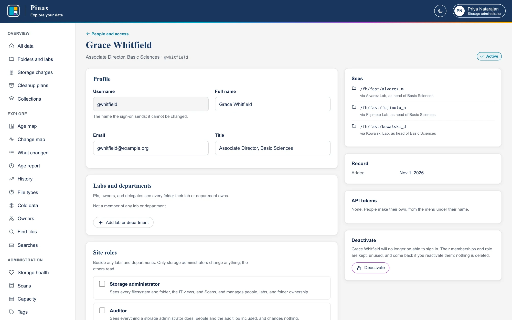

**Labs and departments** lists every lab and department with its members and folders. *Add lab or department*
adds one: a slug (its short ID), a name, whether it is a lab or a department (which decides its free tier), its
division, and its research area. A lab's page changes its details or deactivates it: its members stop seeing its
folders, which stay its own, and charged to it, until they are moved.

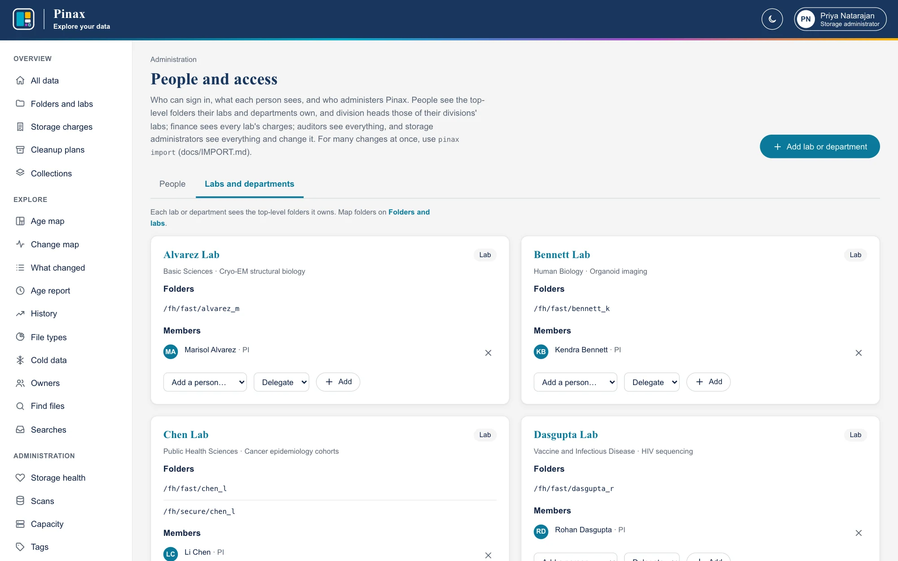

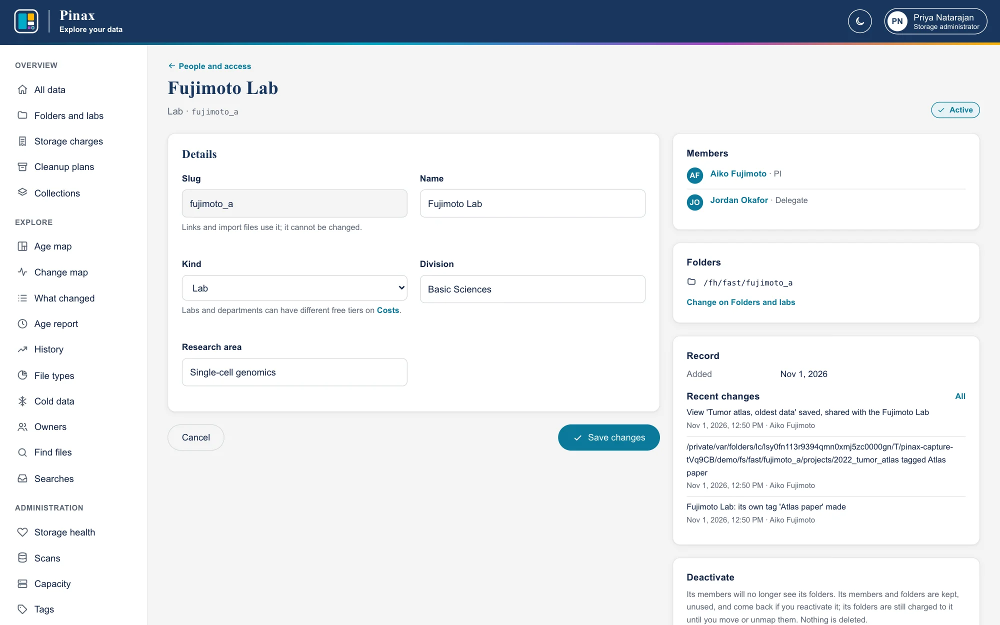

For many people at once, `pinax import` reads CSV files with a dry run first ([IMPORT.md](IMPORT.md)).

## API tokens

Scripts read Pinax, or act for someone, with API tokens instead of signing in, however people sign in
([API tokens for scripts](USER-GUIDE.md#api-tokens-for-scripts)). *API tokens*, in the sidebar for administrators
and auditors and in everyone's menu, has three lists:

- **Your tokens**: everyone makes their own, reading only or with their access, for a week to a year
  (`PINAX_TOKEN_MAX_DAYS`, 365 by default). Pinax shows each once and keeps only its SHA-256.
- **Service tokens**: for a service rather than a person, such as a finance system or a dashboard. An administrator
  names the service and chooses what it reads: as finance (every lab's charges, the chargeback statement, and the
  prices behind them) or as an auditor (everything). A service token belongs to no one, so it keeps working when
  whoever made it leaves, and it only reads.
- **Everyone else's tokens**, with when each was made, when it expires, and when and from where it was last used.

An administrator can **Revoke** any token, here or on its person's page; a person revokes their own. Deactivating a
person revokes their tokens, and reactivating them does not bring them back. Making and revoking a token is
audited, and so is every change made with one, with the token's name: *with the token “…”* in a person's or lab's
recent changes, and `token` in the event's detail. No token can make or revoke tokens, or change a password.

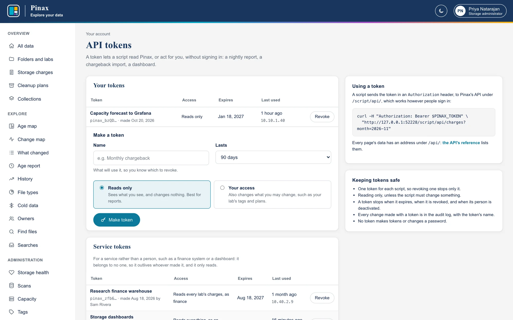

## Access review

Who has access to what, as of now, for a periodic review (a recertification) and a record that it was done.
*Access review*, in the sidebar of administrators and auditors, has:

- **Worth a look**: active labs and departments with no PI or owner, people who can sign in and see nothing, API
  tokens that change what their person may change, and, with local sign-in, people with access who have not signed
  in for 90 days.
- **Site roles**: every storage administrator, auditor, finance officer, and division head, with when each was
  given.
- **Labs and departments**: each one's members and their roles, with when each was given, the heads of its
  division, and its folders, with when it came to own each where that was changed in Pinax.
- **People**: each active person's access, the folders they see and why (*via* a lab, or as head of a division),
  their live API tokens, and, with local sign-in, when they last signed in.

*Find* narrows every list to a person, lab, division, role, or folder. **Download CSV** has a row for each piece of
access each person has (one saying *none* for someone who sees nothing), with what it lets them see and since when,
for a spreadsheet or the review's record. Only active people and labs are listed: deactivated ones give no access,
and are counted.

**Record a review**, once you have gone through it, keeps who reviewed it, when, a note, and how much access there
was, in the audit log (`access.reviewed`); *Reviews* lists the latest. It changes no one's access, so auditors may
record it too.

Pinax records when access was given from 0.12.0 on: a role or membership given before says *Not recorded*.
Changing a member's role (delegate to PI) gives it again, from then.

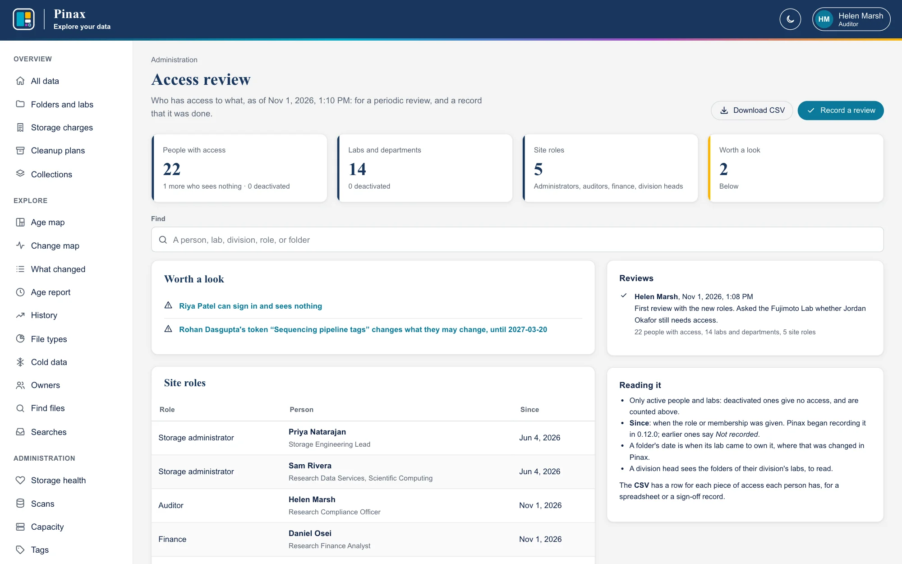

## Scans

Every snapshot: its filesystem, when its scan started, its status, entries and files, size, scan errors, how long
the scan and its index took, the index's size, and the fs-inventory version and the scan's status. **Automatic
ingest** at the top says whether the watcher (`pinax ingest --watch`) is running, when it last looked, and what it
did.

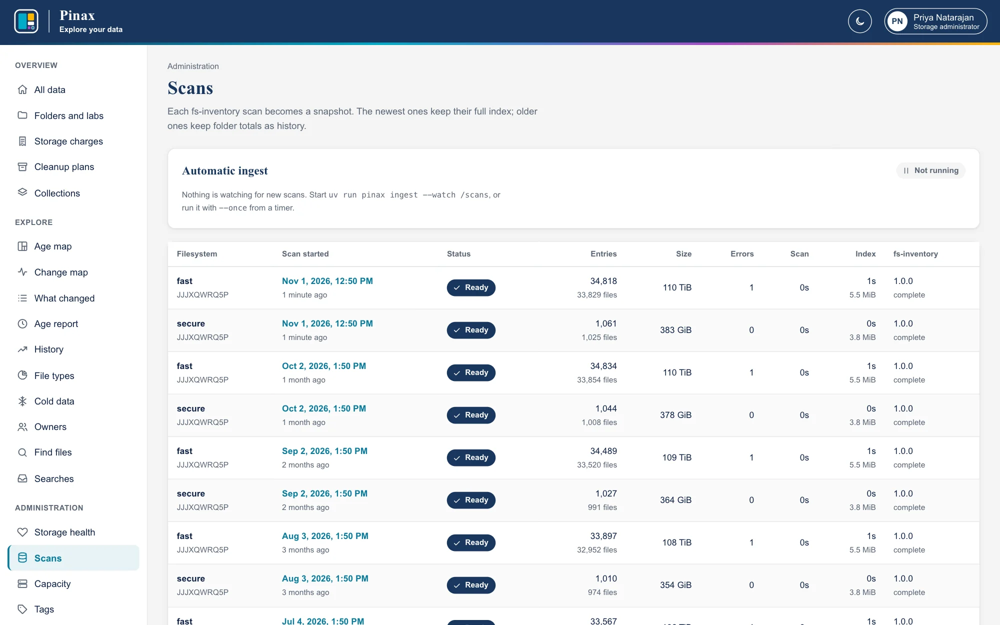

- **Ready**: indexed and kept in full; click its date to open every report on that scan.
- **Pruned**: its index was deleted to keep `PINAX_KEEP_SNAPSHOTS`; its folder history is kept, in *History*.
- **Skipped**: automatic ingest found it but did not load it (an incomplete or unverified scan), with why.
- **Failed**: the index could not be built, with the error. Fix the cause and `pinax ingest` the scan again.

Scans are added by `pinax scan` and automatic ingest ([Scans](DEPLOYMENT.md#scans)); `pinax rebuild` builds an index
again, and `pinax check` checks one against fs-inventory ([CLI.md](CLI.md)).

## Storage health

What is wrong with the storage, as its latest scans show: **scan errors** (folders the scanner could not open, so
their totals are lower bounds), **folders not read completely**, **large folders** (single directories with very
many entries, slow for every tool), **small-file hotspots** (folders of many tiny files, which use space and inodes
out of proportion), **problem file names** (names with a newline, a leading dash, characters Windows does not
allow, or not in Unicode's NFC form, which break scripts and copies to other systems), and **accounts that no
longer exist** (files owned by a uid with no account).

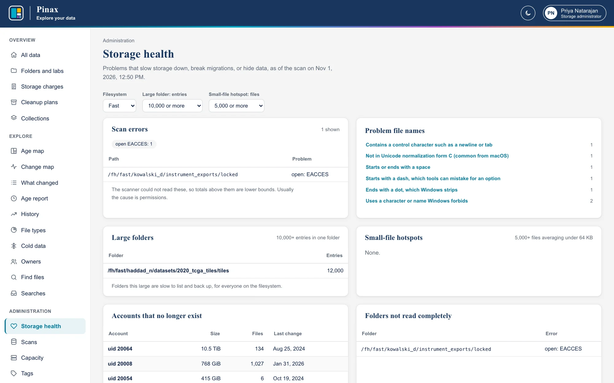

## Capacity

How much each filesystem holds, how much is used, how fast use grows at the trend of the last six months, and when
it fills. `pinax scan` records what the storage reports with each scan; a capacity set here (*From*, *Capacity*,
*Unit*, *Set capacity*) takes its place from its day on, and a later one can be scheduled for an expansion. Use is
measured by the storage's own figure once there are scans that have it, otherwise by space on disk, otherwise by
size.

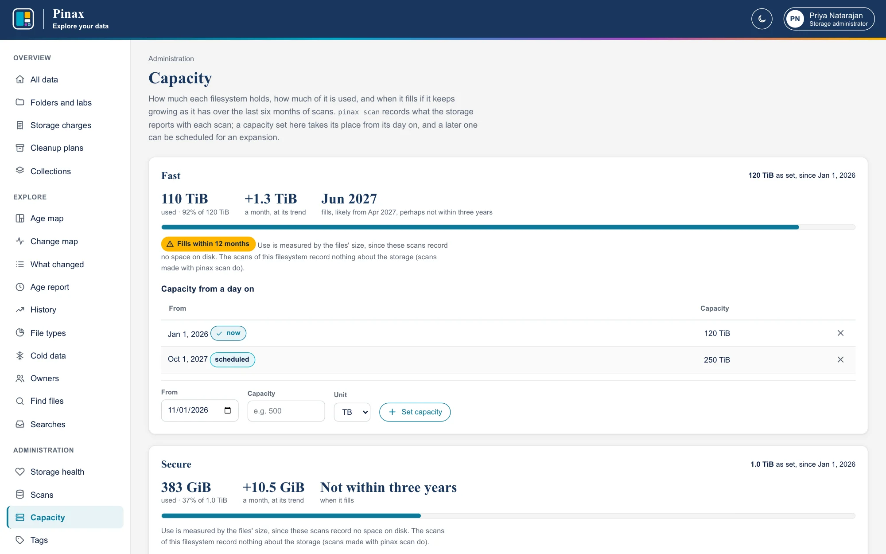

A filesystem that fills within `PINAX_FILL_WARNING_MONTHS` (12) is flagged on *All data*. The fill date is looked for
up to three years ahead; at the fast end of the trend's range, Pinax also gives the earliest it could fill.

## Costs

What each filesystem's storage costs a month, in `PINAX_CURRENCY`, and how much is free:

- **Price per month**: *From*, *Price*, and *Per* (TB, TiB, GB, or GiB) adds a price from a day on, until the
  next. Earlier prices are kept, so past months keep what they had.
- **Free tier**: an amount free for *Every lab*, for *Every department*, or for one lab as an **exception** (its own
  allocation, from a grant say), from a day on. *End a lab's own* ends an exception, so the default applies again.

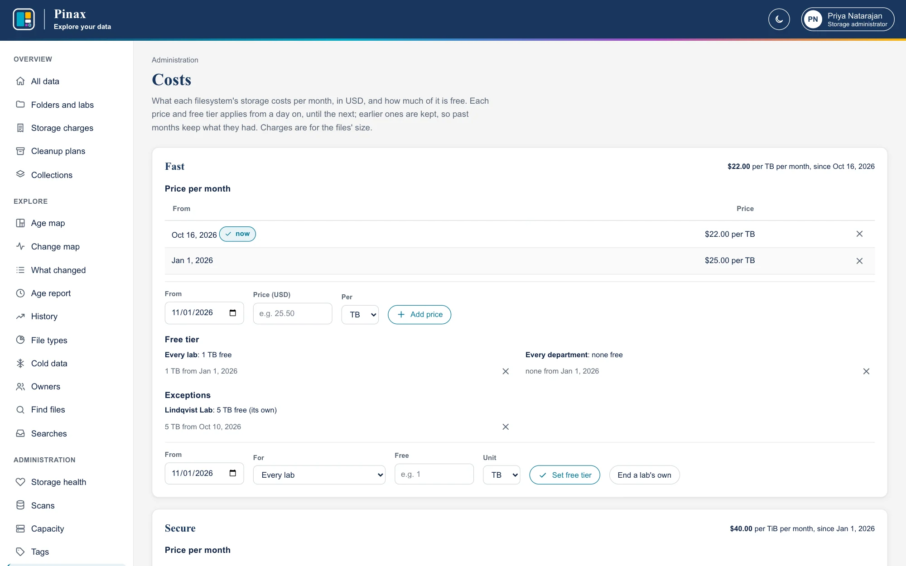

Charges are for the files' size. A change that reaches back before this month changes past months' charges; every
change is audited ([Charges and statements](DEPLOYMENT.md#charges-and-statements)).

## Chargeback

Every lab's and department's charge for a month, most first, the totals by filesystem, and the storage no one owns
(*Unbilled*), with **Download CSV**, the statement for finance. *The next 12 months* adds up what every lab will pay
at its trend.

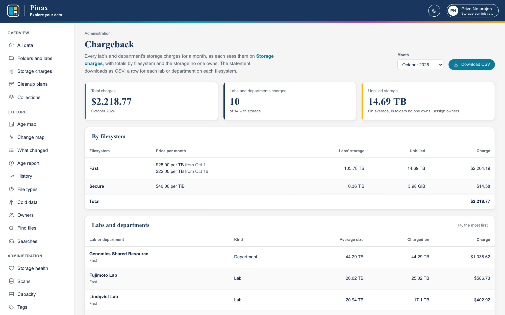

This month's figures are estimates until the month ends; send statements for months that are over.

## Tags

The standard tags every lab can put on its folders. Each has a label and a key, a description, and a value type:
a **flag** (no value), **text** (one value, or more than one), a **date**, or a **choice** from the site's own list.
*Applied by* says whether lab PIs and delegates apply it, or administrators only (as for *Data classification*). A
tag can **protect** folders: a flag (*Legal hold*) or a date (*Keep until*) keeps them out of cleanup plans.

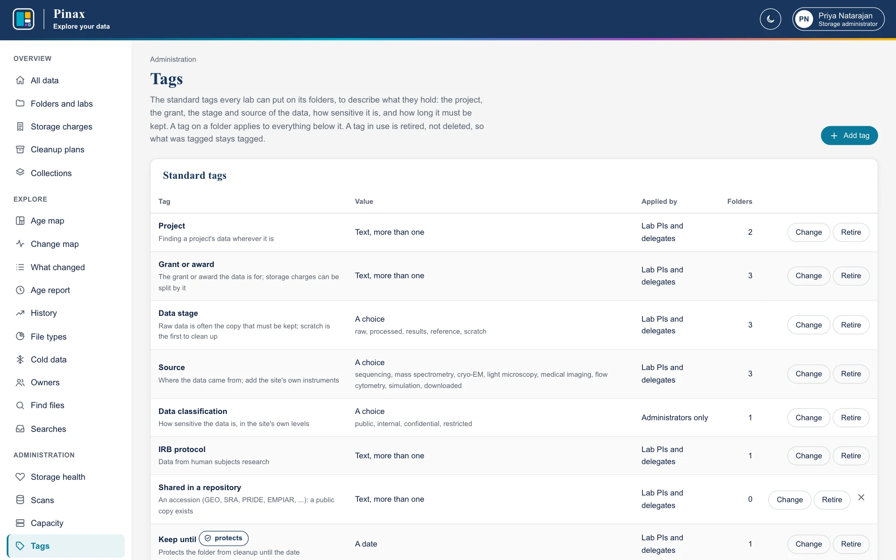

- **Add tag** adds one; **Change** edits it (its type cannot change once it is used, and a choice in use cannot be
  taken away).
- **Retire** stops a tag from being applied; what was tagged stays tagged, and **Bring back** undoes it. An unused
  tag can be deleted (the cross).
- **Labs' own tags** are listed below the standard ones: labs make them from a folder's panel on the age map.
- **Fold into a standard tag**, on a lab's tag that folders have, is for a lab's tag that means what a standard one
  does. Choose the standard tag and, if it takes a value, the value, or keep each folder's own (a flag gives its
  name, which only text takes). Every folder with the lab's tag gets the standard tag instead, and the lab's tag is
  retired. Where a folder already has a standard tag that takes one value, the folded value replaces its own. A value
  the standard tag cannot take (one that is not among a choice's, or not a date) is refused and nothing changes, and
  a retired standard tag cannot be folded into. The fold is audited.

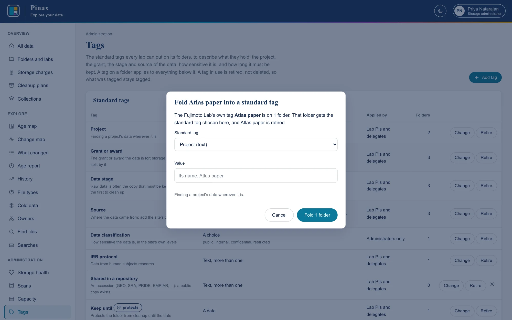

To tag many folders at once, `pinax tags import` reads a CSV of filesystem, path, tag, and value, with a dry run
first ([CLI.md](CLI.md#pinax-tags)).

## Every lab's cleanup plans

An administrator's *Cleanup plans* shows every lab's plan at once: what they would free and save in all, by
filesystem, the largest folders planned, and each lab's total, so IT can see what cleanup is coming and what is
done.

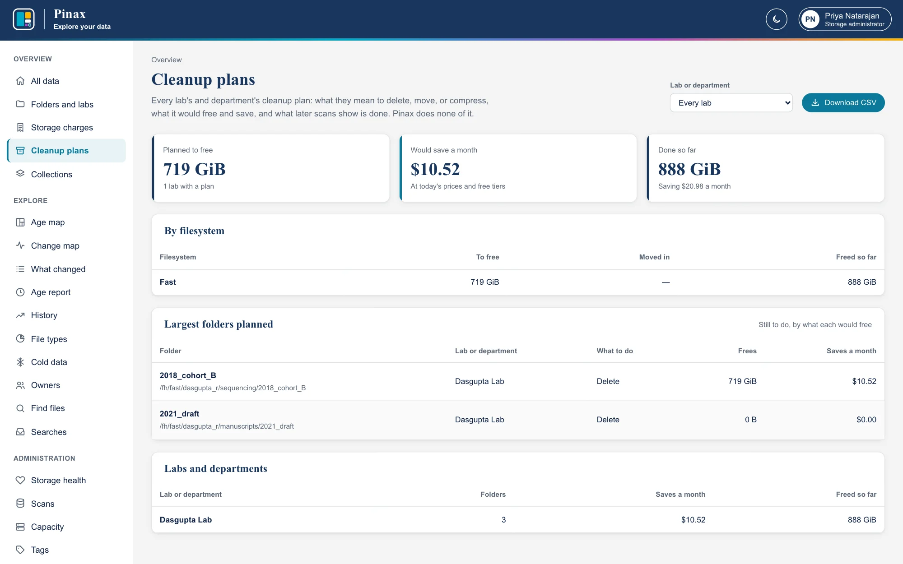

## The audit log

Every change made in the app, by import, and from the command line, and every sign-in with local sign-in, is in the
audit log: who made it, when, from where, and what changed. *Audit log*, in the sidebar of administrators and
auditors, shows it newest first, 50 changes a page, each with its time, who made it (or *Command line* with the
account that ran it, or *Pinax* for scans it ingested), the API token it was made with, the address it came from,
and what it changed; *Details* opens what was recorded. Find changes by any of:

- **Person**: changes they made, and changes made to them (their roles, labs, and tokens).
- **Change**: one action, such as `plan.added`, or every one of a kind, such as every change to cleanup plans.
- **Lab or department**: changes to it, its members, its plan, its own tags, and its folders, and folders given to
  it or taken from it.
- **Folder**: changes to a folder and the folders in it, and to who owns the top-level folder it is in (choose its
  filesystem and give its path within it, such as `dasgupta_r/sequencing`); a filesystem alone, every folder on it.
- **From** and **To**: the days, in UTC.

**Download CSV** has every change that matches, as recorded, with its detail as JSON. A person's and a lab's page
show their recent changes, with *All* for the rest; *All data* shows the latest under *Recent activity*.

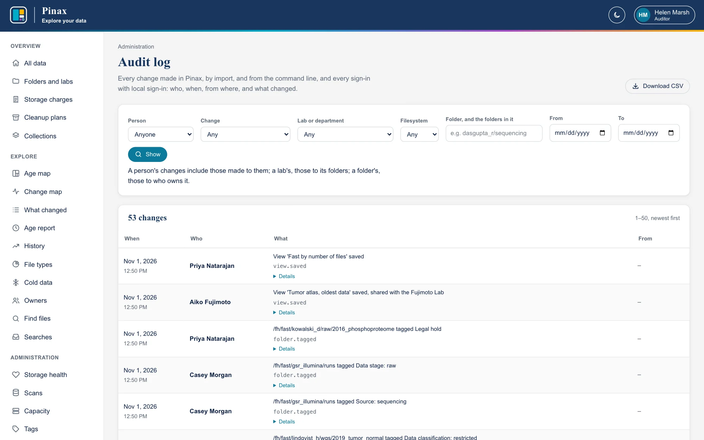

Each event is also written to Pinax's log once its change is committed, and to `PINAX_AUDIT_LOG` if it is set, for
a site's security monitoring ([Logs](DEPLOYMENT.md#logs)). Changes made before 0.12.0 have no address, except
sign-ins. The whole log is the catalog's `audit_event` table
([Monitoring and operations](DEPLOYMENT.md#monitoring-and-operations)).
