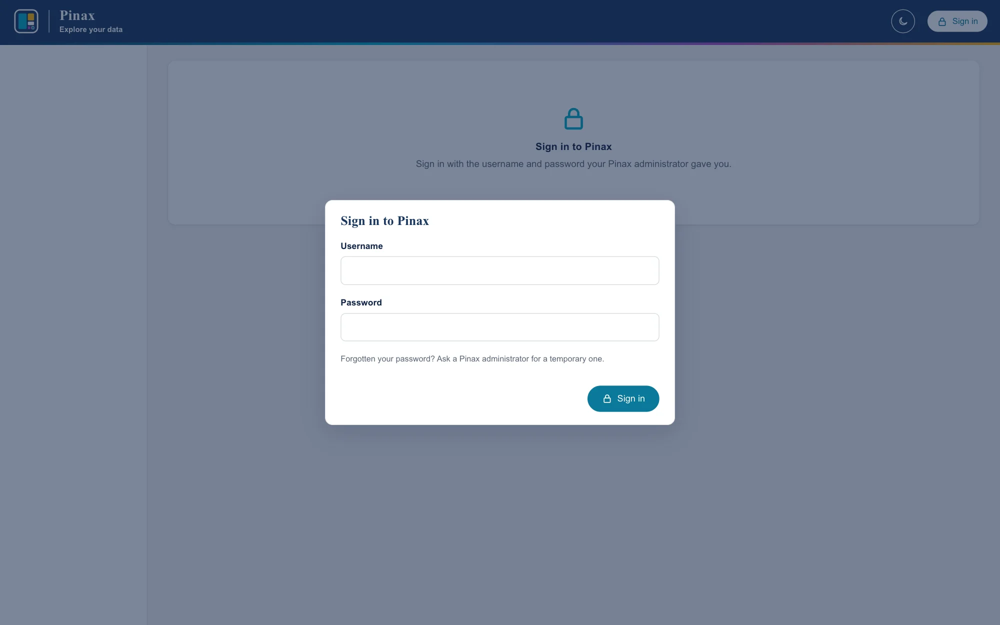

# Deployment

Installing Pinax on a Linux server: the services, single sign-on, scans and keeping them, upgrades, sizing, backups,
charges and statements, and operations.
The files this guide installs are in `deploy/`. This guide is checked against the tests and a local run; the
pilot installation (wave 11 in `pinax-spec/roadmap.md`) will confirm it on a real server.

## Shape of a deployment

```text
  browser ──► oauth2-proxy (sign-on, :443 or :4180) ──► pinax-web (127.0.0.1:8001)
                                                              │ reads
  pinax-scan@fast.timer ──► fs-inventory scan ──► /var/lib/pinax/scans/fast/<date>/
                                                              │ watched by
                                                       pinax-ingest ──► /var/lib/pinax/snapshots/
```

- **Scans** run where the filesystem is mounted with good metadata performance: the Pinax server itself (the
  `pinax-scan@` timer), or a storage node or NFS client that writes into the scan folder. fs-inventory reads
  only metadata, never file contents.
- **Ingest** (`pinax-ingest`) watches the scan folder and builds an index from each new scan. It needs the scan
  folder, not the filesystem.
- **The web app** (`pinax-web`) reads only `/var/lib/pinax`: the catalog and the indexes. It listens on this
  host only, and believes the username header only from oauth2-proxy.

## What you need

- A Linux server with systemd. 10 or more cores; 16 GB of memory for the index build (8 GB) and a few open
  indexes (4 GB each at most); fast local SSD for `/var/lib/pinax` (see [Sizing](#sizing)).
- [uv](https://docs.astral.sh/uv/), which installs the Python Pinax needs (3.13).
- Read access to the filesystems' metadata from the host that scans them.
- A way for people to sign in, one of:
  - **single sign-on**: an OpenID Connect identity provider (for example Microsoft Entra ID) and
    [oauth2-proxy](https://oauth2-proxy.github.io/oauth2-proxy/) 7 (step 6);
  - **passwords Pinax keeps**, for a site without single sign-on: an HTTPS reverse proxy such as nginx or Caddy
    in front of Pinax ([Signing in without single sign-on](#signing-in-without-single-sign-on)).

  The demo's persona switcher (`PINAX_AUTH_MODE=demo`) lets anyone be anyone; Pinax refuses to start with it when
  `PINAX_ENVIRONMENT=prod`.

## Install

### 1. A user and folders

```bash
sudo useradd --system --home-dir /var/lib/pinax --shell /usr/sbin/nologin pinax
```

```bash
sudo install -d -o pinax -g pinax -m 0750 /var/lib/pinax /var/lib/pinax/scans
```

### 2. Pinax and fs-inventory

```bash
sudo git clone https://github.com/robert-mcdermott/pinax.git /opt/pinax
```

```bash
cd /opt/pinax && sudo git checkout v0.10.0 && sudo env UV_PYTHON_INSTALL_DIR=/opt/pinax/.python uv sync --frozen --no-dev
```

```bash
sudo /opt/pinax/scripts/install-fs-inventory.sh
```

`uv sync` makes `/opt/pinax/.venv`, with the locked dependencies only; `UV_PYTHON_INSTALL_DIR` keeps the Python it
installs (if the system has no 3.13) out of root's home, where the `pinax` user could not run it. The installer
puts the pinned fs-inventory release in `/opt/pinax/bin/`, after checking its SHA-256 and version.

### 3. Settings

```bash
sudo install -d -m 0755 /etc/pinax && sudo install -m 0640 -g pinax /opt/pinax/deploy/pinax.env /etc/pinax/pinax.env
```

`/etc/pinax/pinax.env` sets production mode, the data folders, and sign-on through the proxy; every setting is in
[CONFIGURATION.md](CONFIGURATION.md). To run `pinax` commands as the service does, define this in your shell:

```bash
pinax() { sudo -u pinax bash -c 'set -a; . /etc/pinax/pinax.env; exec /opt/pinax/.venv/bin/pinax "$@"' pinax "$@"; }
```

### 4. Filesystems, labs, and people

Register each filesystem by the root the scan records, and how people know it if that differs:

```bash
pinax filesystem add fast /fh/fast --name Fast --description "Primary research storage"
```

If the scanning host mounts it elsewhere (for example `/mnt/fast`), register that root and add
`--display-root /fh/fast`.

Then import labs, people, memberships, and folder ownership ([IMPORT.md](IMPORT.md)); give IT staff
`is_admin` `true` in `people.csv`. Look at the dry run, then apply it:

```bash
pinax import /srv/pinax/onboarding
```

```bash
pinax import /srv/pinax/onboarding --apply
```

Usernames must be what the sign-on proxy sends (step 6): with Entra ID and the default header, the user
principal name, such as `jdoe@example.org`. People, labs, and departments can also be added and changed one at a
time under *People and access*, and folders mapped under *Folders and labs*. Someone must be added, and active,
before they can sign in.

### 5. The services

```bash
sudo cp /opt/pinax/deploy/systemd/pinax-*.service /opt/pinax/deploy/systemd/pinax-scan@.timer /etc/systemd/system/
```

```bash
sudo systemctl daemon-reload && sudo systemctl enable --now pinax-web pinax-ingest
```

```bash
sudo systemctl enable --now pinax-scan@fast.timer
```

| Unit | What it runs |
|---|---|
| `pinax-web.service` | `pinax serve` on 127.0.0.1:8001 |
| `pinax-ingest.service` | `pinax ingest --watch`: each new scan in `PINAX_SCAN_ROOT`, once ([Scans](#scans)) |
| `pinax-scan@.service`, `.timer` | `pinax scan <filesystem> --no-ingest`, weekly (Sunday 01:00); one timer per filesystem |

All run as `pinax`, with the filesystem read-only to them except `/var/lib/pinax` (change `ReadWritePaths` if
`PINAX_VAR_ROOT` or `PINAX_SCAN_ROOT` is elsewhere). The scan service has one
capability, `CAP_DAC_READ_SEARCH`, so that it can list every directory and read every file's metadata without
running as root. If scans run on another host instead, skip the timer and have that host write into
`/var/lib/pinax/scans` (or another folder `pinax-ingest` watches).

### 6. Sign-on with oauth2-proxy

1. Register an application with the identity provider, with the redirect URI
   `https://pinax.example.org/oauth2/callback`, and create a client secret.
2. Install oauth2-proxy 7 (7.3 or later, for `upstream_timeout`) as `/usr/local/bin/oauth2-proxy`, and a system
   user for it.
3. Copy and edit its files: `deploy/oauth2-proxy/pinax.cfg` to `/etc/oauth2-proxy/pinax.cfg` (tenant, client
   ID, email domain, address), the client secret to `/etc/oauth2-proxy/client-secret`, and
   `deploy/oauth2-proxy/pinax.env` to `/etc/oauth2-proxy/pinax.env` with a cookie secret. Make the secrets
   readable only by the oauth2-proxy user.
4. Start it: `deploy/oauth2-proxy/oauth2-proxy.service`, if your package has no unit of its own.

oauth2-proxy signs people in, removes any user headers a browser sends, and passes the signed-in user to Pinax
as `X-Forwarded-User`, `X-Forwarded-Email`, and `X-Forwarded-Preferred-Username`. `PINAX_AUTH_HEADER` says
which one is the Pinax username. Pinax believes it only from `PINAX_TRUSTED_PROXIES` (this host, by default);
the same header from anywhere else gets *401*. If oauth2-proxy runs on another host, put its address in
`PINAX_TRUSTED_PROXIES` and make Pinax listen where only that host can reach it. It waits five minutes for an
answer from Pinax (`upstream_timeout`; its default is 30 seconds), longer than Pinax lets a request run
(`PINAX_QUERY_TIMEOUT`, 180 seconds), so a long search ends with Pinax saying why. `/api/health` is open without
sign-in, for monitoring.

### Signing in without single sign-on

With `PINAX_AUTH_MODE=local`, people sign in with a username and a password that Pinax keeps (hashed with
scrypt), instead of steps 6's proxy. Put an HTTPS reverse proxy in front of Pinax (nginx, Caddy, or a load
balancer, forwarding to `127.0.0.1:8001`): in production the session cookie is sent only over HTTPS. Let it wait
longer for an answer than `PINAX_QUERY_TIMEOUT` (180 seconds), so a long search ends with Pinax's explanation
rather than a gateway error: for nginx, `proxy_read_timeout 300s;` (its default is 60 seconds).

Nobody can sign in until someone has a password, so make the first administrator on the server. It prints a
temporary password, which they must change when they first sign in:

```bash
pinax user add jdoe@example.org --name "Jane Doe" --email jdoe@example.org --admin
```

(`pinax` here is the shell function from step 3, which runs it as the service does.)

From then on, administrators add people and give them temporary passwords under *People and access*; Pinax
makes each password up and shows it once. A forgotten password, or an account locked after five failed sign-ins
(for 15 minutes), needs a new temporary password from an administrator, or `pinax user password USERNAME` on the
server. Sessions last 12 hours and end on signing out, on deactivation, and when a password is set or changed.
Every sign-in, failure, lock, and password change is in the audit log, never the passwords. Add the reverse
proxy's address to `PINAX_TRUSTED_PROXIES`, so the log, the audit, and each session record the person's own address
from `X-Forwarded-For` rather than the proxy's. One limit: failures lock an account rather than slowing down an
address.



To move to single sign-on later, set `PINAX_AUTH_MODE=header` and follow step 6. People, labs, and memberships
stay; passwords are no longer used. Usernames must then be what the proxy sends (with Entra ID, usually the user
principal name, such as `jdoe@example.org`), so a site that may move should use those usernames from the start.

### 7. Check the installation

```bash
curl -s http://127.0.0.1:8001/api/health
```

It answers `{"status": "ok", ...}`. Sign in through oauth2-proxy as an administrator and open *Scans*:
*Automatic ingest* should say *Watching*. Run the first scan rather than waiting for Sunday:

```bash
sudo systemctl start pinax-scan@fast
```

When it has been ingested (`journalctl -u pinax-ingest -f`, or *Scans*), check its numbers against
fs-inventory's own (the ID is on *Scans*, or from `pinax snapshots`):

```bash
pinax check 1
```

## Scans

Weekly scans suit most research filesystems; nightly ones suit smaller filesystems or ones you watch closely.
A scan of a billion files takes hours, so each scan gets its own folder, and only scans that verify are loaded.

`pinax-ingest` looks for scan folders (with a `manifest.json`) up to three levels below `PINAX_SCAN_ROOT`, oldest
first, and treats each by the status fs-inventory gave it:

| Status | What the watcher does |
|---|---|
| `complete` | runs `fs-inventory verify`, then ingests it (skip the verify with `--no-verify`) |
| `running`, `interrupted` | leaves it alone and looks again next time, since it may still finish or be resumed |
| `incomplete`, `failed` | records it on *Scans* as skipped, with why (`--allow-incomplete` ingests incomplete ones) |

A scan is matched to its filesystem by its root, and is handled once: ingested, skipped, or failed with the error,
all of which show on *Scans*. A failed or skipped scan is never retried automatically; fix the cause and run
`pinax ingest SCAN_DIR` by hand. Scans whose root matches no registered filesystem are named in the watcher's log
and left for later. Any number of watchers and manual ingests may run at once: they share a lock in
`PINAX_VAR_ROOT`, so one index is built at a time and no scan is ingested twice.

*Scans* also shows whether the watcher is alive: it reports what it is doing at every pass, and is shown as not
responding when it misses three. To run it from a timer instead of as a service, use `--once` with the timer's
interval as `--interval`; it exits with code 1 when a scan in that pass failed.

A scan host other than the Pinax server can scan and verify, and write into the watched folder:

```bash
dir=/scans/fast/$(date -u +%Y%m%dT%H%M%SZ)
```

```bash
/opt/fs-inventory/fs-inventory scan /fh/fast -o "$dir" --resolve-ids --threads 64 --stall-timeout 15m && /opt/fs-inventory/fs-inventory verify "$dir"
```

Notes:

- `--resolve-ids` records owner names, which the Owners report and storage health use to flag deleted accounts.
  Run it on a host that resolves the same accounts as the storage (LDAP or sssd).
- `fs-inventory probe /fh/fast --threads 16,32,64,128` finds a good thread count without writing anything;
  `PINAX_SCAN_THREADS` sets it for `pinax scan`.
- An interrupted scan can be continued with `fs-inventory resume`; the watcher waits for it.
- `pinax scan` also asks the filesystem for its total, used, and available space (`statvfs`, which reads no file)
  and writes them to `pinax.json` beside the manifest, so *Capacity* knows how much the filesystem holds and how
  much of it the storage counts as used, its snapshots included. A scan made with fs-inventory directly, as above,
  has none: set the filesystem's capacity on *Capacity* instead (a capacity set there also takes the place of
  what the storage reports, for storage whose mount shows a quota or a shared pool).
- Pinax never deletes scan folders. Keep the scan of every snapshot that still has its index (the newest
  `PINAX_KEEP_SNAPSHOTS` of each filesystem), so it can be rebuilt after an upgrade and checked; once a snapshot
  is pruned, its scan is of no further use to Pinax and can be deleted. `pinax snapshots` lists each snapshot's
  status (`ready` or `pruned`) and scan folder. See [What Pinax keeps](ARCHITECTURE.md#what-pinax-keeps).
- Pinax reads only the parts a scan's manifest lists, so leftovers of an interrupted run in the folder are ignored.
- fs-inventory does not enter other filesystems mounted below the root unless asked. If labs' folders are their
  own filesystems (filesets, exports, automounts), scan with `--cross-mounts` (add it to `PINAX_SCAN_EXTRA_ARGS`);
  otherwise each is counted as a folder not read, with nothing in it, and Pinax says its totals are lower bounds.
- Scans in microseconds (the default) and in nanoseconds (`--time-unit ns`) are both accepted.

## Checking a filesystem's numbers

After the first scan of a filesystem, and after upgrading Pinax, check the index against fs-inventory's own
computation of the same totals with `pinax check SNAPSHOT_ID`. It runs `fs-inventory rollup` on a copy of the
scan's manifest (the scan folder is not written to) and compares every directory, printing the ones that differ.
Rollup keeps an age histogram of about 0.5 KB for every directory down to the depth compared, so on scans with
tens of millions of directories bound it, for example `--age-depth 4`; the other totals are still compared at
every depth. Each index also records how every directory changed since the filesystem's previous scan, and the
check compares that too, with a rollup of the previous scan, as long as its scan folder is kept.

## Upgrading

```bash
cd /opt/pinax && sudo git fetch --tags && sudo git checkout vX.Y.Z && sudo env UV_PYTHON_INSTALL_DIR=/opt/pinax/.python uv sync --frozen --no-dev
```

```bash
sudo systemctl restart pinax-web pinax-ingest
```

```bash
pinax rebuild --outdated
```

`CHANGELOG.md` says when a release changes the index format (`INDEX_VERSION`). Older indexes still answer, but
without what the new format adds, so `pinax rebuild --outdated` builds them again from their scans, oldest first
(each one is compared with the snapshot before it),
in place: each snapshot stays available on its old index until the new one replaces it, and keeps it if the build
fails. The web app opens rebuilt indexes without a restart. `pinax rebuild SNAPSHOT_ID` rebuilds one, for example
one whose index was lost. Rebuilding needs the snapshot's scan: a snapshot whose scan folder was deleted keeps its
old index, without what the new format adds, and the rebuild says so.

The catalog is upgraded by migrations, when the web app or the watcher starts: `CHANGELOG.md` says when a release
has one, and `journalctl -u pinax-web` shows `Upgraded the catalog to revision ...`. Back the catalog up first
([Backups](#backups)). Processes that start together take turns, and a catalog from 0.9.0 or earlier (made before
migrations) is adopted the same way. Where database changes go through a database administrator, set
`PINAX_DB_AUTO_UPGRADE=false`: Pinax then refuses to start with a catalog that is behind and says so, and

```bash
pinax db upgrade --sql
```

prints the SQL to review and apply, or `pinax db upgrade` applies it. A catalog that a newer release has upgraded is
refused by an older one: to go back to an older release, restore a backup made before the upgrade.

## Sizing

| Item | Rule of thumb |
|---|---|
| fs-inventory scan output | about 40 bytes per entry (40 GB per billion), for each scan kept; Pinax never deletes them ([Scans](#scans)) |
| Snapshot index | about 56 bytes per file (56 GB per billion), times `PINAX_KEEP_SNAPSHOTS` (6), plus about 60 bytes per file new or removed since the scan before |
| Building an index | free space for the new index beside the kept ones (it replaces the oldest only after the ingest), and while it builds, for a staged copy of the files and DuckDB's spill files: about 2–3 times an index in all |
| Index build | about 1.2 seconds per million files on 10 cores (100 million in two minutes, a billion in about 20 minutes, measured on synthetic data); 8 GB of memory is enough, spilling beside the index beyond it, and more is no faster |
| Query memory | `PINAX_QUERY_MEMORY_LIMIT` per open index (4 GB at most), up to 8 open, in the one web process; more memory left over for the operating system's page cache keeps indexes fast |
| Long requests | Pinax stops a request after `PINAX_QUERY_TIMEOUT` (180 seconds), or when the browser leaves; the proxy in front must wait longer (oauth2-proxy's `upstream_timeout` is 5 minutes in `deploy/oauth2-proxy/pinax.cfg`, against its own default of 30 seconds; nginx's `proxy_read_timeout` is 60 seconds by default). `PINAX_WIDE_QUERIES` (2) searches of a whole filesystem run at once, and `PINAX_QUERY_THREADS` below the core count keeps one from slowing every page |
| Catalog | small: about one row per top-level folder per scan for history (2,000 folders scanned weekly add about 100,000 rows a year) |

Put `/var/lib/pinax/snapshots` on fast local SSD or NVMe: indexes are read with many small range requests. Scans
are read in one pass, at ingest and rebuild, so they can live on slower, cheaper disk: point `PINAX_SCAN_ROOT` there,
and add it to the units' `ReadWritePaths`. For a billion-file filesystem with the defaults, six indexes take about
340 GB and six scans about 240 GB, plus any older scans not yet deleted.

### A filesystem of two billion files

Projected from the 100-million-file measurements ([Measured performance](ARCHITECTURE.md#measured-performance)),
with the defaults:

| | Two billion files |
| --- | --- |
| Each scan | about 80 GB; the six of the kept snapshots about 480 GB, on cheaper disk |
| Each index | about 112 GB, so about 670 GB for six, plus `file_changes` (about 2.4 GB for a week in which 2% of the files are new or removed) |
| Building an index | about 45 minutes on 10 cores, with 8 GB of memory, and 250–350 GB of free space while it runs: about 1–1.2 TB of NVMe for the indexes in all |
| Web server memory | up to 32 GB for 8 open indexes at 4 GB each, plus page cache: 64 GB or more |
| Age map, types, owners, cold folders, history, charges | tens of milliseconds, as at 100 million: they read folder totals, not files |
| A lab's search | grows with the lab's files: a lab of 300 million files searches like a filesystem of that size, in several seconds |
| A search of the whole filesystem | about a minute, then about as long again for the count of matches; two at a time |
| *What changed* since the previous scan | the new and removed files read `file_changes`, fast; the folder lists read every folder, about 0.1 s per 250,000 folders, so tens of seconds at 50 million folders or more |
| *What changed* of the whole filesystem since an older scan | compares both scans' files, minutes: longer than the time limit, so ask it of a folder |
| Rebuilding six indexes after an upgrade that changes the index format | about 5 hours, one after another; the old indexes answer meanwhile |

These are projections from synthetic scans with about 41 files per folder. Production filesystems often have
fewer files per folder, and everything that reads every folder (the build's subtree totals, cold folders, and
comparison, and whole-filesystem folder reports) grows with folders, so measure the first production scan: *Scans*
gives its build time and index size, its manifest the count of folders, and the web app's journal names each
request Pinax stopped (`Stopped /api/files: timeout after 180 s`).

## Catalog database

The catalog is SQLite in WAL mode by default, `/var/lib/pinax/pinax.db`: a file the Pinax processes open
themselves, with no database server to run, which suits one server running the web app and the watcher. It holds
everything that cannot be made again (see [What Pinax keeps](ARCHITECTURE.md#what-pinax-keeps)), so back it up.
PostgreSQL is the choice when IT would rather run the catalog as one of its databases, backed up, replicated, and
monitored as the others are ([The catalog database](ARCHITECTURE.md#the-catalog-database)).

`pinax db status` names the catalog (never its password) and says whether it is up to date. Releases that change the
catalog do it with migrations, applied when Pinax starts ([Upgrading](#upgrading)).

### PostgreSQL

PostgreSQL 14 or later. Pinax needs one database and a role that owns it:

```bash
sudo -u postgres createuser --pwprompt pinax
```

```bash
sudo -u postgres createdb --owner pinax pinax
```

Install Pinax with its PostgreSQL driver (step 2 of [Install](#install), with `--extra postgres`):

```bash
cd /opt/pinax && sudo env UV_PYTHON_INSTALL_DIR=/opt/pinax/.python uv sync --frozen --no-dev --extra postgres
```

Point Pinax at it in `/etc/pinax/pinax.env`, without the password, and with TLS when the database is on another host:

```bash
PINAX_DATABASE_URL=postgresql://pinax@db.example.org/pinax?sslmode=verify-full
```

Put the password in the `pinax` user's `~/.pgpass`, which only that user may read (PostgreSQL's driver refuses it
otherwise):

```bash
echo 'db.example.org:5432:pinax:pinax:THE-PASSWORD' | sudo -u pinax tee /var/lib/pinax/.pgpass >/dev/null && sudo chmod 0600 /var/lib/pinax/.pgpass
```

Then `pinax db upgrade` (the shell function from [step 3](#3-settings)) creates the catalog (Pinax would also do it when it
starts), and `pinax db status` should say *up to date*. Each Pinax process keeps up to `PINAX_DATABASE_POOL_SIZE`
(10) connections open, and as many more at busy times; the web app, the watcher, and commands each have their own.
Connections show as `pinax` in `pg_stat_activity`.

### Moving a catalog from SQLite to PostgreSQL

`pinax db copy` copies every table of the catalog into an empty database, in one transaction, then sets
PostgreSQL's id sequences past the copied rows and compares every table's count. Indexes and scans stay where they
are. With the PostgreSQL database and role made, the driver installed, and the password in `~/.pgpass` (above):

```bash
sudo systemctl stop pinax-web pinax-ingest
```

```bash
pinax db copy postgresql://pinax@db.example.org/pinax?sslmode=verify-full
```

Then set `PINAX_DATABASE_URL` to the same URL in `/etc/pinax/pinax.env` and start the services again; keep
`pinax.db` until PostgreSQL has been backed up. A catalog from 0.9.0 or earlier is upgraded first
(`pinax db upgrade`), and the copy refuses a database that is not empty, or a source that is not up to date. The
copy works the other way too, from PostgreSQL into a new SQLite file (`--from` names the source).

## Backups

- **Catalog**: back up `/var/lib/pinax/pinax.db`, daily. It is the only part that cannot be made again: people,
  labs, memberships, folder ownership and its history, snapshot records, folder history for every scan, prices
  and free tiers, password hashes, and the audit log. It is small. Copying the file while Pinax runs can catch it
  half-written, so use SQLite's online backup (the `sqlite3` package), which is safe at any time:

  ```bash
  sudo install -d -o pinax -g pinax -m 0750 /var/lib/pinax/backup
  ```

  ```bash
  sudo -u pinax sqlite3 /var/lib/pinax/pinax.db ".backup '/var/lib/pinax/backup/pinax-$(date +%F).db'"
  ```

  Then copy the backup off the server. To restore, stop `pinax-web` and `pinax-ingest`, put the backup in place
  of `pinax.db`, delete `pinax.db-wal` and `pinax.db-shm`, and start them again. Keep the import files too.

  On PostgreSQL, the database's own backups apply, IT's or `pg_dump`, which is safe while Pinax runs:

  ```bash
  sudo -u pinax pg_dump --format=custom --file=/var/lib/pinax/backup/pinax-$(date +%F).dump pinax
  ```

  To restore, stop `pinax-web` and `pinax-ingest`, restore into an empty database with `pg_restore --no-owner
  --role=pinax --dbname=pinax`, and start them again.
- **Indexes**: optional; `pinax rebuild` makes each again from its snapshot's scan, if that is kept.
- **Scans**: keep those of snapshots that still have their index ([Scans](#scans)); the rest can be deleted.
- A catalog backup holds top-level folder names and people's names and emails; copies of indexes or scans hold
  every file and folder name and owner names. Protect them as you would the filesystem's own metadata.

## Charges and statements

Administrators set prices and free tiers on *Costs*; labs see their charges under *Storage charges*, and
*Chargeback* has every lab's for a month, with a CSV statement for finance. Things to know when supporting them:

- **Statements are worked out when asked, not stored.** A month is final once it has ended, but some changes
  reach back into it: a price or free tier added or removed from a day in that month or before, and a scan dated
  in that month that is ingested late. Moving a folder to another lab takes effect from that moment, so it does not
  change past months. Download the CSV when you send it to finance, and keep it.
- **A lab's kind has no history.** Charges use whether a lab is a lab or a department now, so changing it changes
  which free tier its past months had. *People and access* asks before the change.
- **Ownership history starts with 0.5.0.** A folder that changed owner before the upgrade to 0.5.0 is charged to
  its current owner for earlier months.
- **Deactivating a lab does not stop its charges.** Its folders stay mapped to it, so they are charged to it until
  they are moved or unmapped on *Folders and labs*.
- **Folders no one owns are not charged.** *Chargeback* lists them as unbilled; map them to a lab or department.
- **The month in progress is an estimate**, as if the latest scan held until the month's end; statements for it
  are marked `estimate`.

How a charge is worked out is in [ARCHITECTURE.md](ARCHITECTURE.md#costs).

## Monitoring and operations

`/api/health` needs no sign-in and names nothing: it answers `ok`; `degraded` when a ready snapshot's index is
missing or automatic ingest has stopped or stopped responding; and 503 when the catalog cannot be read.

### Logs

Logs go to the journal (`journalctl -u pinax-web -u pinax-ingest`), as text:

```text
2026-10-28 20:32:50 INFO pinax: Pinax 0.10.0 started: environment prod, sign-in header, catalog postgresql+psycopg://pinax@db.example.org/pinax, data in /var/lib/pinax
2026-10-28 20:32:57 INFO pinax.request: GET /api/tree 200 in 122 ms, 6 index queries 27 ms [user=fujimoto_a address=10.20.4.17 request=c4b8784fe19b4890]
2026-10-28 20:33:02 INFO pinax.audit: view.saved: View 'Tumor atlas' saved, shared with the Fujimoto Lab [user=fujimoto_a address=10.20.4.17 request=51d0c2a7e3b94b11]
```

- **Requests**: one line for each request to the API, with the method, the path (never the query string, which
  can name files), the status, the time taken and the part of it in index queries, and the person, their address,
  and the request's ID. The ID is also the response's `X-Request-ID`, so a person's report of a problem can be
  found; a trusted proxy's own `X-Request-ID` is kept, so its log and Pinax's match. Behind a proxy in
  `PINAX_TRUSTED_PROXIES`, the address is the person's own, from `X-Forwarded-For`. A request slower than
  `PINAX_SLOW_REQUEST_SECONDS` (5) is a warning marked *slow*, and a failed one is a warning too. Pages, scripts,
  and `/api/health` are not logged.
- **Audit**: every audit event (each change in the app, by import, and from the command line, and each sign-in and
  failed sign-in with local sign-in) is logged by `pinax.audit` once its change is committed, with who made it and
  from where; from the command line, with the account that ran it.
- **Never logged**: passwords, session cookies and tokens, request bodies, query strings, or the catalog's password.

For a log collector (Splunk, Elastic, Loki, or the like), `PINAX_LOG_FORMAT=json` writes one JSON object per line,
with `ts` (UTC), `level`, `logger`, `message`, `request_id`, `user`, and `address`, and the details of each request
(`http`: method, path, route, status, ms, bytes, queries, query_ms, slow) and audit event (`audit`: id, action,
actor_id, detail) as fields of their own. To write to files rather than the journal, and to keep every audit event
in a file of its own for security monitoring:

```bash
PINAX_LOG_FILE=/var/log/pinax/pinax.log
PINAX_AUDIT_LOG=/var/log/pinax/audit.log
```

The services' units make `/var/log/pinax`; `deploy/logrotate/pinax` rotates the files daily and keeps 90 days:

```bash
sudo install -m 0644 /opt/pinax/deploy/logrotate/pinax /etc/logrotate.d/pinax
```

The audit log in a file is a copy: the catalog keeps every event, and *People and access* shows them.

### Metrics

`/metrics` answers in Prometheus's format, to trend Pinax and the storage it reports on and to alert when something
goes wrong. It is off until `PINAX_METRICS_TOKEN` is set, and then answers only requests that send that token:

```bash
openssl rand -hex 32 | sudo tee /etc/prometheus/pinax-metrics-token
```

Put the same token in `/etc/pinax/pinax.env` as `PINAX_METRICS_TOKEN=...`, restart `pinax-web`, and add the scrape
job in `deploy/prometheus/pinax-scrape.yml` to Prometheus. `/metrics` is served by the web app, so it is reached
the way pages are: through the proxy in front of Pinax (`deploy/oauth2-proxy/pinax.cfg` lets `GET /metrics` through
without signing in, as it does `/api/health`, and Pinax checks the token), or on Pinax's own port from the
Prometheus host.

The figures name filesystems, never labs, people, or paths. From the catalog, worked out when Prometheus asks (at
most every 15 seconds), and so whichever process did the work:

| Metric | What it is |
|---|---|
| `pinax_scan_last_success_timestamp_seconds`, `pinax_ingest_last_success_timestamp_seconds` | When each filesystem's newest ingested scan was taken, and when it was ingested |
| `pinax_scan_last_failure_timestamp_seconds` | When its newest failed or skipped scan was taken: newer than the last success means the newest scan was not ingested |
| `pinax_scan_duration_seconds`, `pinax_ingest_duration_seconds` | How long the newest scan took fs-inventory, and its ingest Pinax |
| `pinax_filesystem_bytes`, `_allocated_bytes`, `_files`, `_directories`, `_cold_bytes`, `pinax_scan_errors` | The newest scan's totals: its size, space on disk, files, folders, data unchanged for `PINAX_COLD_DAYS`, and entries not read |
| `pinax_filesystem_capacity_bytes`, `_used_bytes`, `_growth_bytes_per_month`, `_fill_timestamp_seconds`, `_fill_earliest_timestamp_seconds` | Capacity, use, its trend, when it fills at the trend, and when it could at the fast end of the trend's range (as on *Capacity*) |
| `pinax_snapshots{status}`, `pinax_index_bytes` | Snapshots by state, and the size of the indexes kept |
| `pinax_watcher_up`, `pinax_watcher_last_heartbeat_timestamp_seconds` | Whether automatic ingest is running and responding |
| `pinax_search_jobs{status}`, `pinax_users{state}`, `pinax_labs{state}`, `pinax_sessions_active` | Searches in the background, people, labs and departments, and local sign-in sessions |
| `pinax_var_size_bytes`, `pinax_var_free_bytes` | Pinax's own disk, `PINAX_VAR_ROOT` |
| `pinax_catalog_up`, `pinax_info{version,database}` | Whether the catalog can be read, and Pinax's version |

From the web app itself, since it started (with `rate()` for rates):

| Metric | What it is |
|---|---|
| `pinax_http_requests_total{method,route,status}`, `pinax_http_request_duration_seconds{method,route}` | Requests by route (its template, such as `/api/views/{view_id}`) and status, and how long they took |
| `pinax_index_queries_total`, `pinax_index_query_seconds_total` | Index queries for requests, and their time |
| `pinax_queries_stopped_total{reason}` | Requests stopped: `timeout`, `busy` (no whole-filesystem turn in time), or `gone` (the browser left) |
| `pinax_wide_queries{state}` | Whole-filesystem file queries running, and waiting for a turn |
| `pinax_search_jobs_finished_total{status}` | Searches in the background finished: done, failed, or stopped |
| `pinax_audit_events_total{action}` | Audit events, by action: `auth.signed_in`, `auth.sign_in_failed`, and `auth.locked` are sign-ins |

and, on Linux, the process's own memory, CPU, and open files (`process_*`). `deploy/prometheus/pinax-alerts.yml` has alert rules
to start from: Pinax or its catalog down, a scan not ingested, a filesystem with no new scan for eight days,
automatic ingest stopped, a filesystem filling within 90 days or 90% full, Pinax's own disk 90% full, slow pages,
server errors, searches turned away for want of a turn, and many failed sign-ins.

### Tasks

| Task | How |
|---|---|
| See scans and their status | *Scans*, or `pinax snapshots` |
| A failed or skipped scan | *Scans* shows the error; fix the cause and run `pinax ingest` on the scan |
| Automatic ingest *not responding* | `systemctl status pinax-ingest` and its journal |
| Too little disk for indexes | Lower `PINAX_KEEP_SNAPSHOTS`; pruning runs after every ingest. A build needs room for one more index while it runs ([Sizing](#sizing)) |
| People see "Pinax stopped this after 180 seconds" | A search or comparison of a whole filesystem read for longer than `PINAX_QUERY_TIMEOUT`: search within a folder, or narrow it by name, type, size, or age. To allow longer, raise `PINAX_QUERY_TIMEOUT` and the proxy's timeout with it. The log names each one (`Stopped /api/files: timeout after 180 s`) |
| People see "Pinax is already running as many searches of whole filesystems as it allows" | Others ran meanwhile: raise `PINAX_WIDE_QUERIES` if the server has the cores and memory |
| Pages are slow while a large search runs | Set `PINAX_QUERY_THREADS` below the number of cores |
| Scan folders filling the disk | Pinax never deletes them: delete the folders of pruned snapshots (`pinax snapshots` lists each one's status and folder) |
| An index was lost or damaged | `pinax rebuild SNAPSHOT_ID`, from its scan; `/api/health` is `degraded` and counts `indexes_missing` while one is missing |
| Someone forgot their password, or is locked out (local sign-in) | Their page under *People and access*, *Set a new temporary password*; or `pinax user password USERNAME` |
| Read the audit log | Each person's and lab's page shows its recent changes, and *All data* the latest under *Recent activity*; every event is in the log too (`pinax.audit`, and `PINAX_AUDIT_LOG` if set), and the whole log is the catalog's `audit_event` table (below) |
| A lab asks why a past month's charge changed | See [Charges and statements](#charges-and-statements) |
| Someone cannot see their lab's data | Check *People and access* (membership) and *Folders and labs* (the folder is mapped to their lab) |
| Someone gets *401* after signing in | Their username (the header named by `PINAX_AUTH_HEADER`) is not an active person in the catalog |
| A folder shows "could not be read completely" | The scanner lacked permission somewhere below it; see *Storage health* |
| Move to a new fs-inventory release | `scripts/install-fs-inventory.sh --version vX.Y.Z`; Pinax reads schema versions 2 and 3 |

The whole audit log, newest first (every change in the app, by import, and from the command line, and every
sign-in with local sign-in; never a password):

```bash
sudo -u pinax sqlite3 /var/lib/pinax/pinax.db "SELECT ts, action, summary FROM audit_event ORDER BY ts DESC LIMIT 100"
```

On PostgreSQL, the same query with `psql`:

```bash
sudo -u pinax psql "postgresql://pinax@db.example.org/pinax" -c "SELECT ts, action, summary FROM audit_event ORDER BY ts DESC LIMIT 100"
```
