# User guide

For the people whose data Pinax reports on: PIs, lab managers, and lab members; for division heads, who read their
division's labs; and for storage administrators when they explore. It goes through every page a lab sees, in the order most people use them. The pictures are of
the [demo](DEMO.md), whose labs and people are fictional. The ideas behind the pages (scans, top-level folders, ages,
cold data) are in [How Pinax sees storage](CONCEPTS.md).

Pinax only reports: it never opens, moves, or deletes a file. What it shows is as of the latest **scan** of each
filesystem, usually taken weekly, so a file written today appears after the next scan.

## Signing in and My data

How you sign in depends on your site: through your organization's single sign-on, or with a username and a password
that Pinax keeps (a temporary one the first time, which you then change). In the demo, you choose who to be.

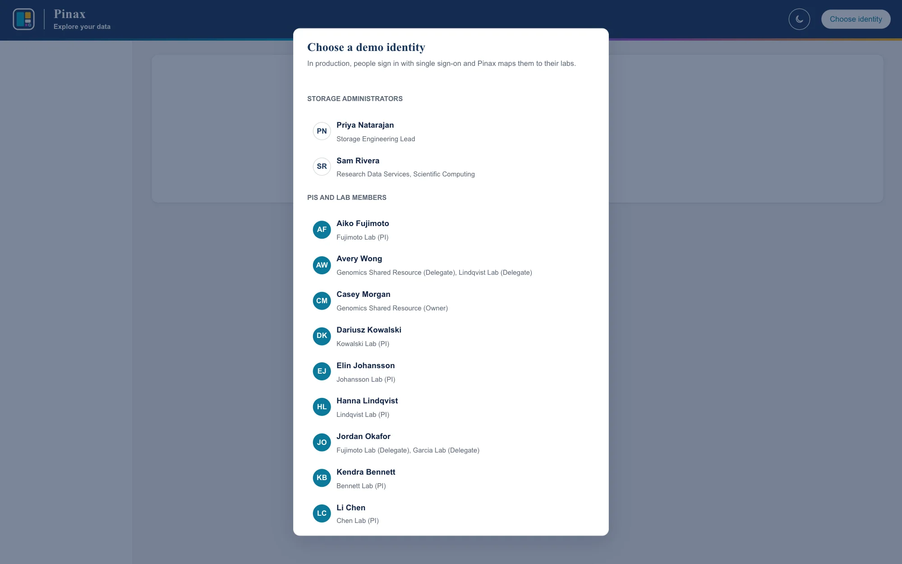

**My data** is the home page. It shows what your labs store, as of the latest scan:

- **Total size**, the files and folders, and how much has not changed for two years or more.
- **Average age**, weighted by size, so a large old file counts for more than many small new ones.
- **Change since the previous scan**, across your folders; click it for their history.
- **Storage charges this month**, an estimate to the month's end, where your site charges for storage.
- **Your folders**: each top-level folder your labs own, on every filesystem, with its size, a bar of its data by
  age (red for recent, blue for old), how much is unchanged for two years or more, and when it last changed.

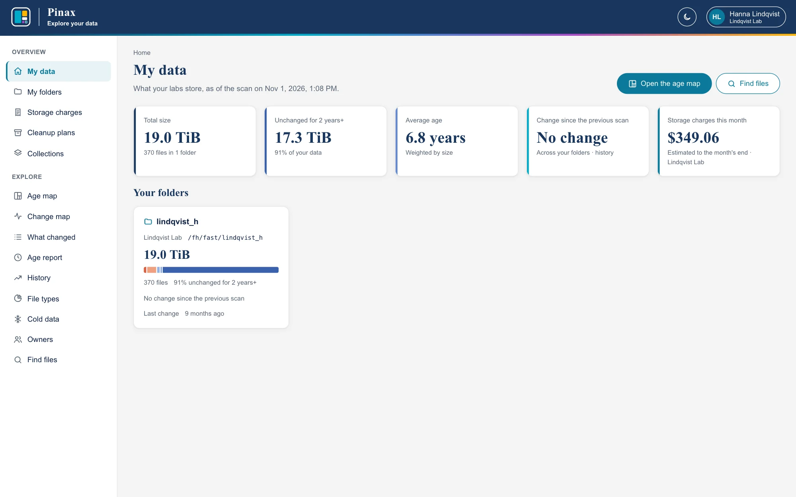

You see the folders your labs own and everything inside them, and nothing else: other labs' folders do not appear
at all. A delegate for two labs sees both. If a folder is missing, ask your storage administrators: it may not be
mapped to your lab yet. A division head sees the folders of their division's labs the same way, to read. Storage
administrators and auditors see every filesystem and folder; their home page is *All data*
([Administration](ADMINISTRATION.md#all-data)). Finance sees every lab's charges, and lands on *Chargeback*
([Site roles](ADMINISTRATION.md#site-roles)).

Every page has the reports for the folder you are in along its top (*Age map*, *Change map*, *What changed*, *Age
report*, *History*, *File types*, *Cold data*, *Owners*, *Find files*), and the scan it shows beside the date. The
moon in the top bar switches between light and dark themes.

## The age map

The age map is a treemap of a folder's subfolders: each tile's area is how much it holds, and its color how old its
data is, from red (changed recently) through orange to blue (unchanged for years). A large dark blue tile is a lot
of data nobody has touched in a long time. Click a tile to go into it; *Up one level* and the path above go back.

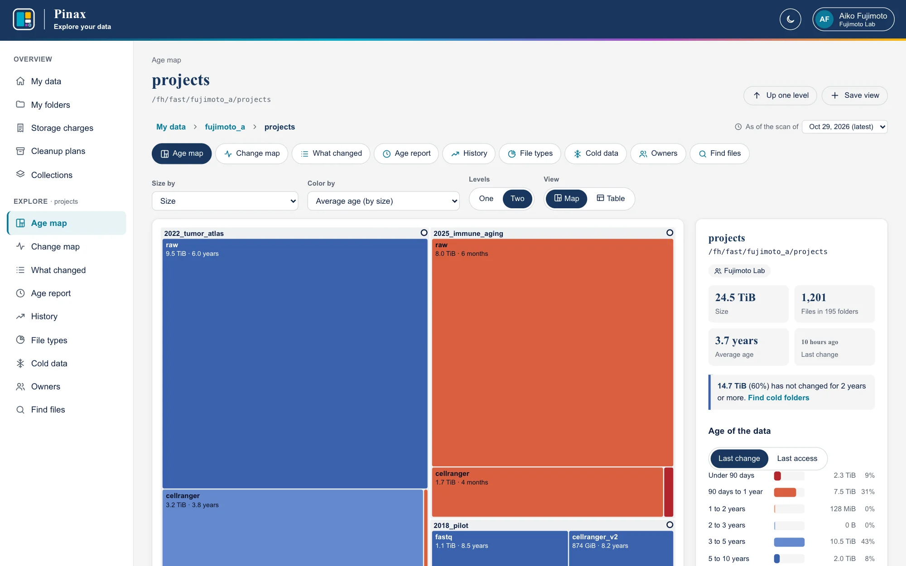

The controls above it:

- **Size by**: tiles sized by *Size* (the files' size), *Space on disk*, *Number of files*, data of one kind (such as
  *Sequencing and genomics*), or data older than a threshold.
- **Color by**: *Average age (by size)*, *Time since the last change*, *Age of the oldest file*, *Time since the last
  access* (where the filesystem records it), *Share that is cold*, or the share of one kind of data.
- **Levels**: one level of subfolders, or two, with each tile's own subfolders drawn inside it. For the icicle and
  the sunburst: four, six, or eight levels.
- **View**: the map; the same folders several levels deep as an [icicle or a sunburst](#icicle-and-sunburst); or the
  folder's subfolders as a table, which can be sorted and read by a screen reader.

Hover a tile for its size, files, ages, and owner. A tile with a dot is tagged, or holds tagged folders
([Tags](#tags-and-collections)).

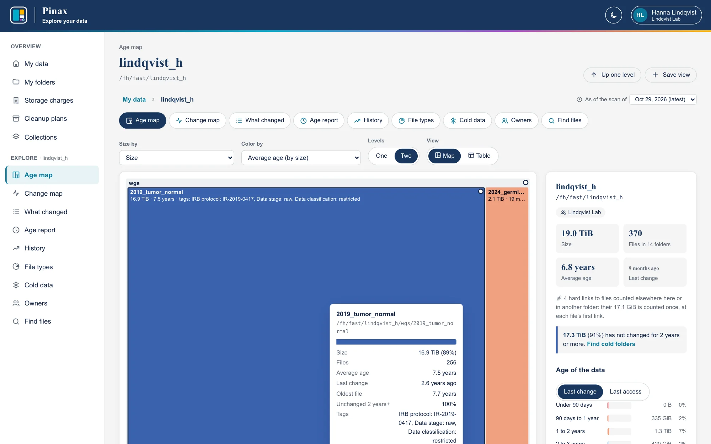

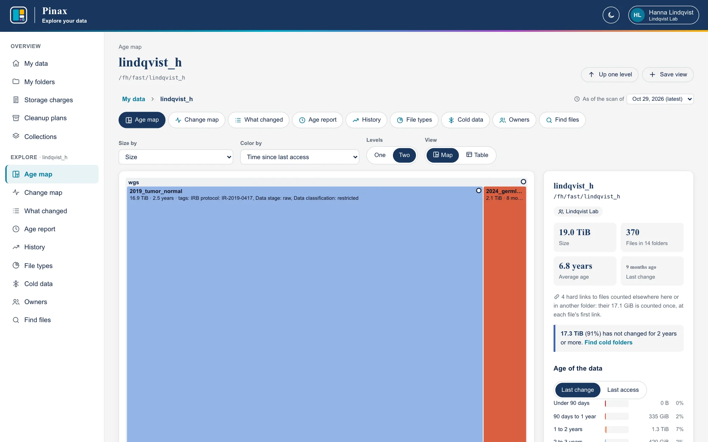

**The panel** beside the map is about the folder you are in: its size, files and folders, average age, last change,
how much is cold (with a link to its cold folders), its data by age (by last change or last access), what kind of
data it is, its owner, its tags, and its place in your lab's cleanup plan. Where a folder could not be read
completely (the scanner lacked permission somewhere below it), the panel says so, and its totals are lower bounds.
Where it holds hard links to files counted elsewhere, it says how much they would have counted again.

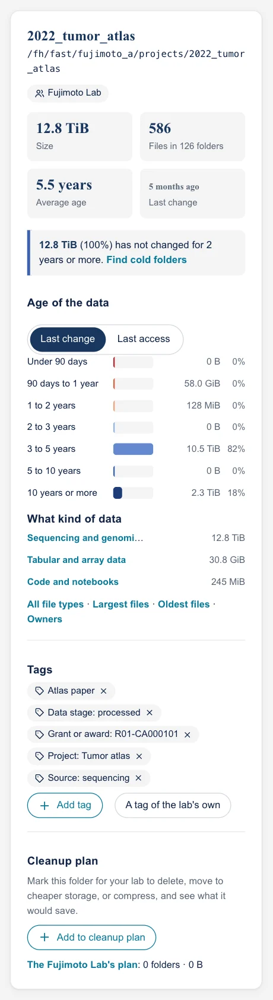

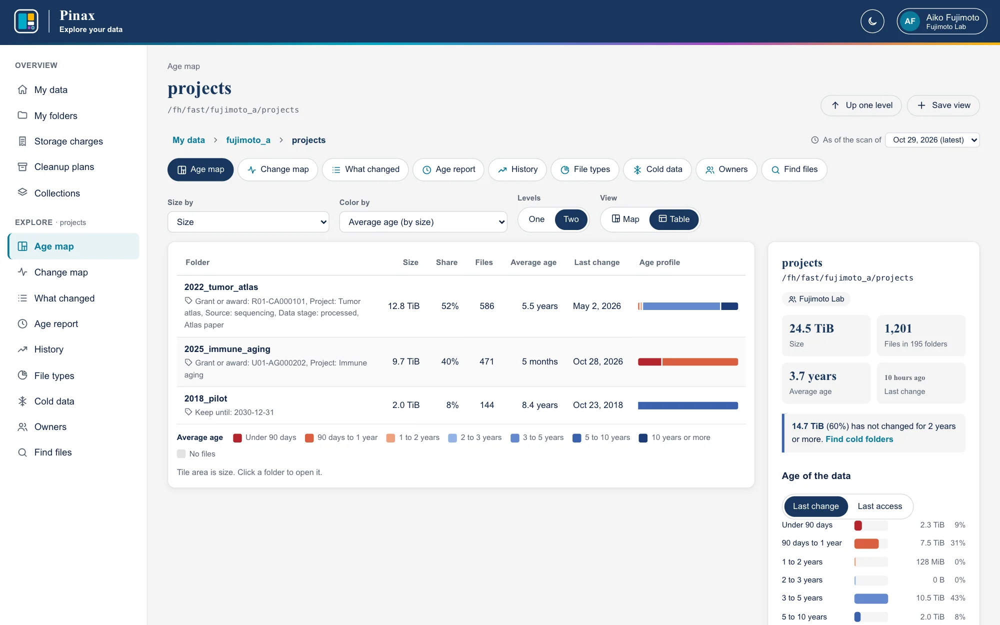

### Icicle and sunburst

The map shows one or two levels of folders at a time, so data deep in a chain of folders (runs inside samples
inside batches) is found by clicking down. The icicle and the sunburst show a folder four, six, or eight levels deep
at once (*Levels*). Each folder is drawn beside the folder it is in, as long as its share of it, and colored as on
the map. The two views draw the same folders in different ways:

- **Icicle**: one column per level, left to right. A folder's height is how much it holds, so sizes are easy to
  compare and names have room.
- **Sunburst**: one ring per level around the folder you are in, clockwise from the top. A folder's angle is how much
  it holds. Outer rings are drawn larger, so compare angles, not areas; read exact sizes from the icicle. Click the
  middle to go up one level.

Folders holding less than 0.25% of the folder you are in are left out, so that the view stays readable. The space
after a folder's subfolders is its own files, and the folders too small to draw. *Size by* and *Color by* work as
they do for the map. Hover a folder for its details, and click it to go into it. The keyboard's Tab key moves through
the first level; the table view lists the folder's subfolders for a screen reader.

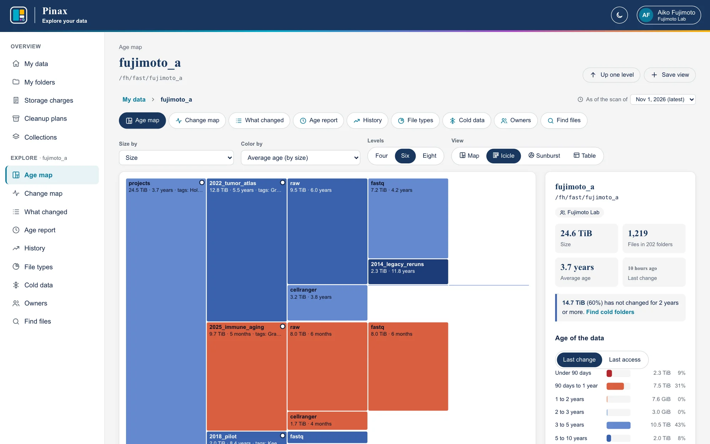

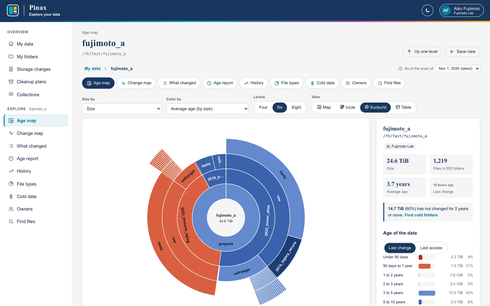

## History and forecasts

*History* draws a folder, a lab, or a whole filesystem over its scans: its size as stacked columns by age, so you
see both how much it grew and whether the new data is keeping its average age down, with its files, cold share,
and average age in small charts beside it. Hover a column for that scan. *Table* shows the numbers, and *Download
CSV* takes them away.

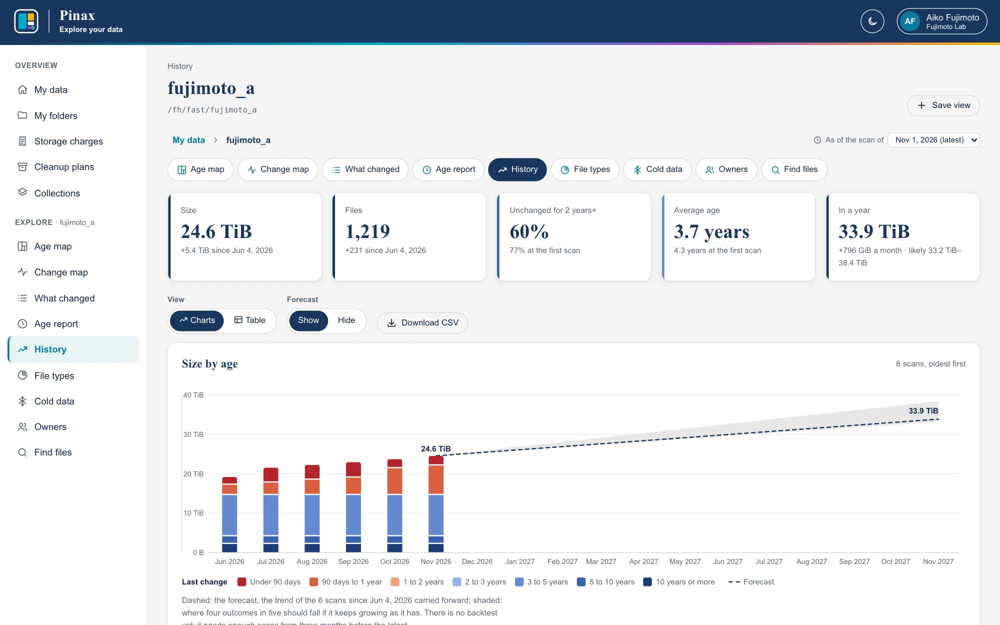

The **forecast** carries the trend of the last six months of scans a year ahead: a dashed line, with a shaded range
where four outcomes in five should fall if it keeps growing as it has. It needs six scans over eight weeks. When a
folder changed in one step (a project moved in or out), the trend starts again after the step. Once there are scans
from three months before the latest, Pinax also shows how far off the same method would have been then (the
*backtest*), so you can judge how much to trust it. *Hide* turns it off.

Older scans keep their folder totals for good, so history goes back further than the scans kept in full.

## Change map and what changed

The **change map** is the age map colored by change: how much each folder grew (teal) or shrank (gold) since an
earlier scan, the previous one by default. New folders and removed folders are drawn, a removed folder keeping the
room it had. *Compare with* picks the scan; the panel lists what grew and shrank most.

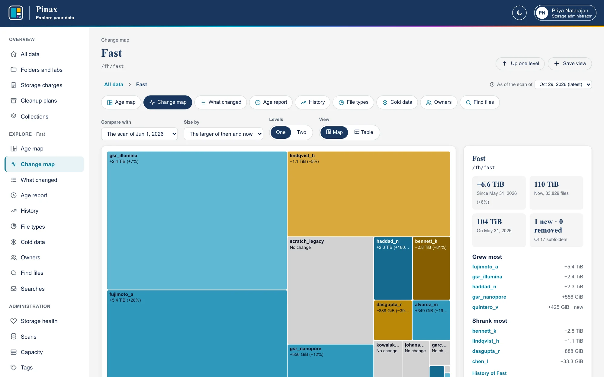

Folders are matched by path, so a folder that was renamed or moved shows as one removed and one new; the tooltip of
a new folder says how old its data is, which tells a move from new data.

**What changed** lists the same changes for any folder and two scans: the change in size, the new and removed files
and folders, where it grew and shrank most, the new and removed folders, and the largest new and removed files. Each
list downloads as CSV.

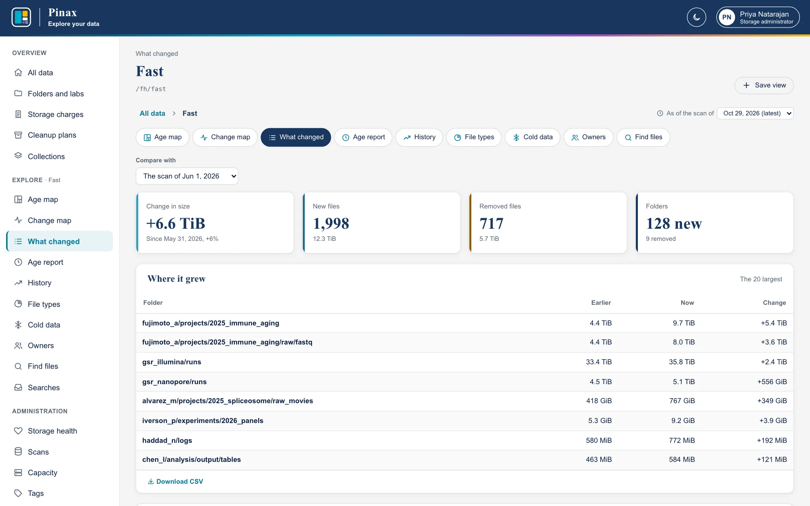

## Reports

The other reports answer one question each about the folder you are in.

**Age report**: the folder's *Age profile* (how much data is in each age bucket), how its data is read (*Reading
ages*, by last access), and each subfolder with its size, average age, last change, oldest file, and age profile, so
you can see which subfolders hold the old data.

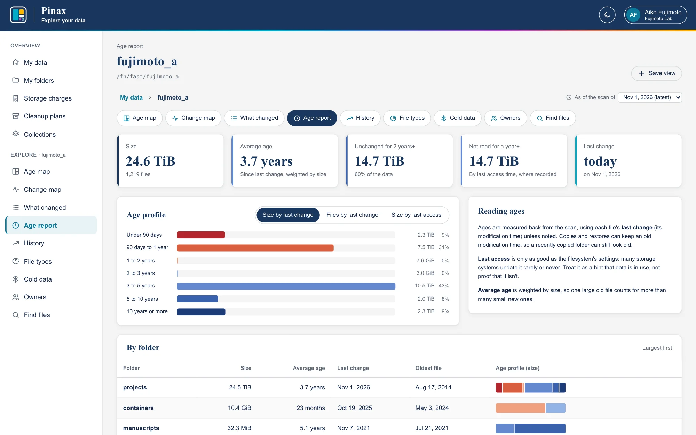

**File types**: how much of each kind of data (sequencing and genomics, imaging, tabular, archives, and so on) and
each file type, with a callout for uncompressed sequencing data, which could be compressed. Click a type to list
its files.

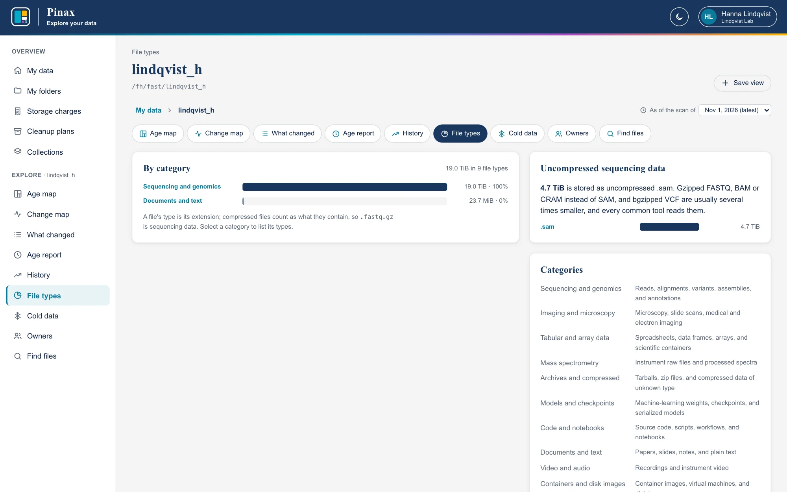

**Cold data**: the largest folders in which everything is older than a threshold (two years by default, or 90 days
to ten years), each a unit that could be archived or deleted whole, with its size and when it last changed.

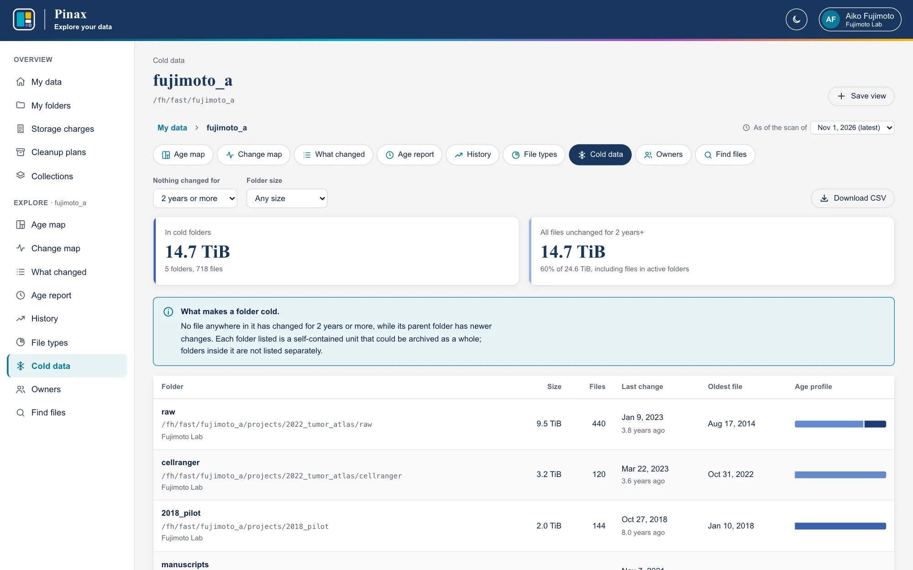

**Owners**: how much each account owns, flagging accounts that no longer exist, whose data may need a new owner.

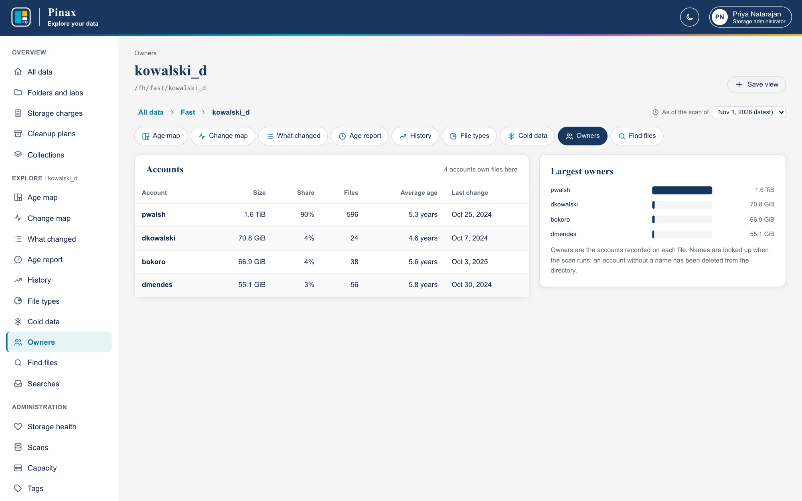

## Finding files

*Find files* searches the folder you are in by name (a pattern such as `*.bam`, or anywhere in the path), category,
type, size, and age, ordered by size, age, or name, and shows the first 500 with the total of every match. *Download
CSV* takes up to 100,000. Searching within a lab's folder is quick; a search of a whole filesystem reads every file
in it.

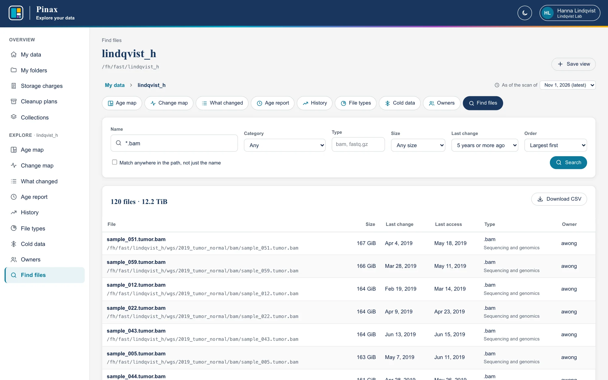

A search of a whole filesystem that would take longer than a page may wait can run **in the background**
(administrators): *Run in the background* on *Find files*, and *Searches* lists it while it runs and keeps every
match, as a table and a CSV, for a week.

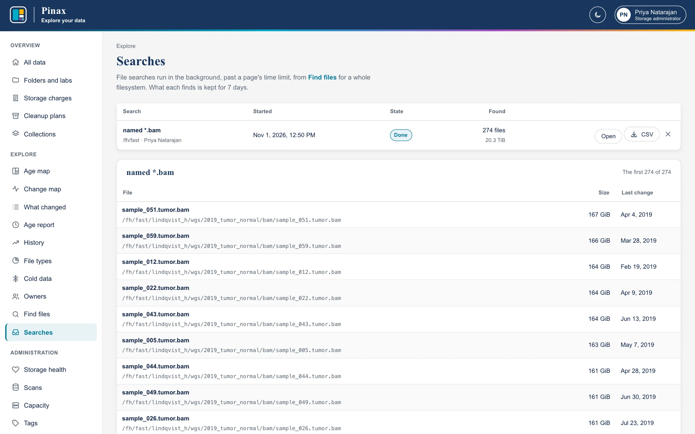

## Storage charges

Where your site charges for storage, *Storage charges* shows what each of your labs pays each month, by filesystem
and folder, and how each charge is worked out: the average size of the lab's folders over the month, less its free
tier, at the filesystem's price. A month in which the price or the free tier changed is worked out in parts. This
month's charge is an estimate to the month's end. *Month* picks another month; *Past months* lists them all.

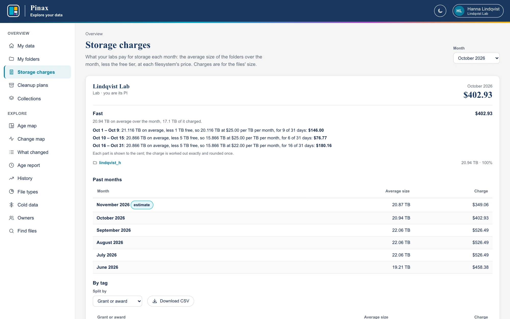

**The next 12 months** shows what the lab will pay if it keeps growing as it has, with a range, at the prices and
free tiers already scheduled.

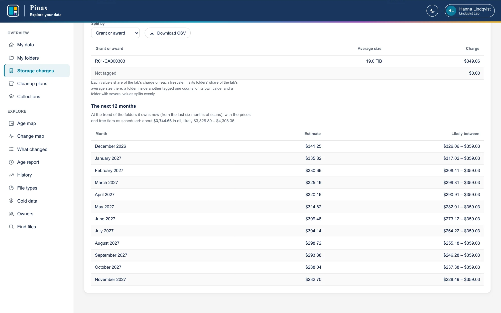

**By tag** splits a month's charge by a tag's values, such as a grant: each value's share of the charge is its
folders' share of the lab's size over the month, and the rest is untagged. *Download CSV* takes the split away, for a
grant's report.

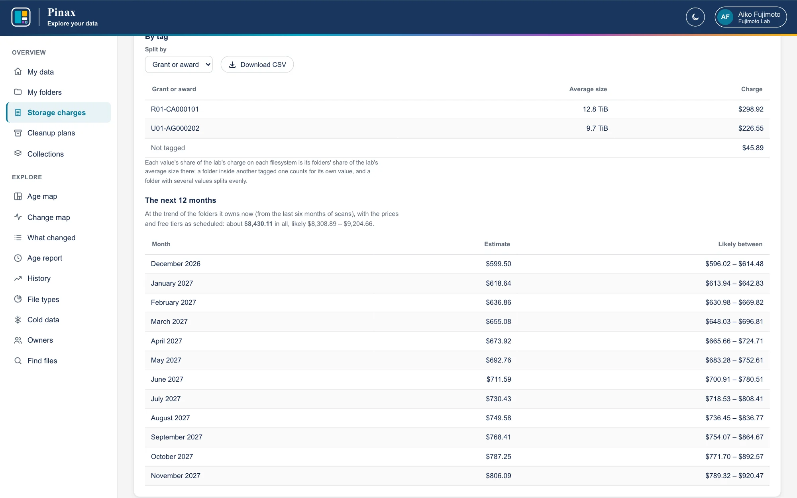

## Cleanup plans

A **cleanup plan** lists the folders a lab means to delete, move to cheaper storage, or compress, with what each
would free and how much the lab's monthly charge would fall. Pinax does none of it: the lab does the work, and later
scans show what was done. A PI or delegate adds a folder from its panel on the age map (*Add to cleanup plan*, in the
*Cleanup plan* box), with what to do and a note; *Change* edits it, and the cross takes it out.

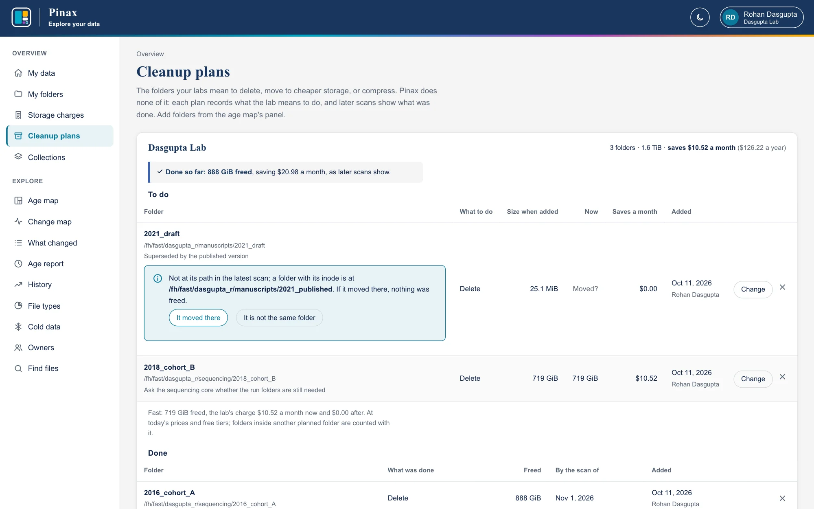

After each scan, each folder is:

- **Done**, once it is gone (or, for a move or compression, smaller), with what it freed and saves a month.
- **Partly done**, when some of it is gone.
- **Moved?**, when it is no longer at its path but a folder with the same inode is somewhere else: it was renamed or
  moved, so nothing was freed. *It moved there* makes the plan follow it; *It is not the same folder* says it was not.
- **To do**, with what it would save.

Compression is estimated from each file type's usual ratio. **Suggestions** lists folders worth adding: workflow
working folders (Nextflow `work/`, Snakemake `.snakemake/`, conda package caches), large cold folders, and
uncompressed sequencing data. A folder on legal hold, or kept until a date that has not come, cannot go in a plan.

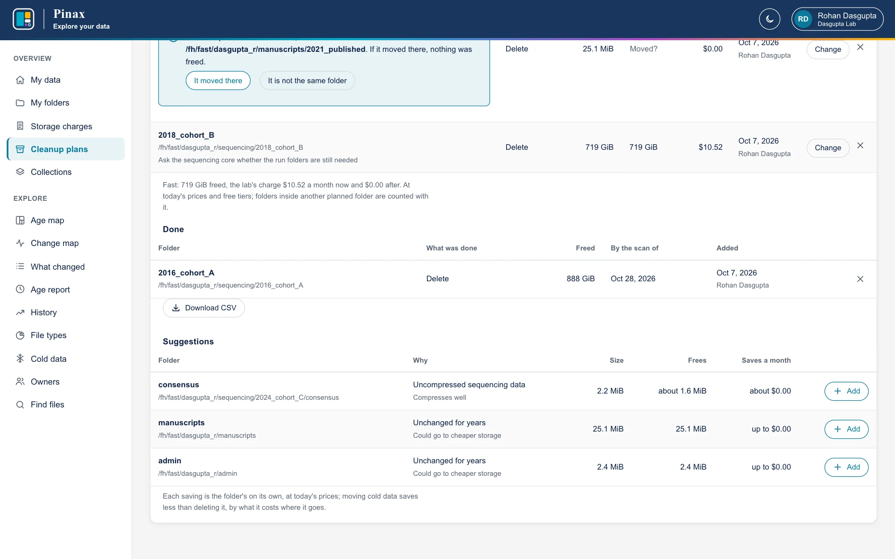

## Tags and collections

**Tags** describe folders in terms a lab and IT share: *Project*, *Grant or award*, *Data stage*, *Source*, *IRB
protocol*, *Data classification*, *Shared in a repository*, *Keep until*, and *Legal hold*, from a list your storage
administrators keep, and tags your lab makes for itself. A tag applies to everything below its folder.

A PI or delegate tags a folder from its panel on the age map: *Add tag*, the tag, and its value. Inherited tags show
there too, with the folder they come from; to remove one, remove it where it was put. Some tags (such as *Data
classification*) only administrators apply. *Keep until* and *Legal hold* protect a folder: it cannot go in a
cleanup plan.

**Collections** finds data by its tags, wherever it is: every folder that has all of the tags you choose (with a
value, or any), on its own or from a folder above, among the folders you may see, with their size, owner, monthly
cost, history, and forecast.

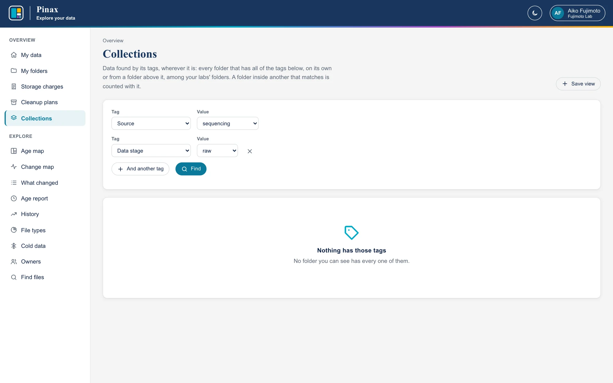

## Saved views and earlier scans

**Save view** on any report keeps the page as it is (the report, the folder, and its settings) under a name, for
you or shared with one of your labs. *My data* lists your views and those shared with your labs, with who sees each;
a shared view shows each person only what they may see.

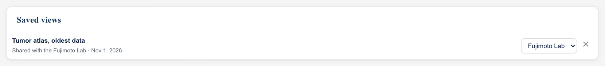

**Earlier scans**: every report shows the latest scan, or any earlier one still kept in full, chosen beside the date
(*As of the scan of*). The header then says it is an older scan, every report and link stays on it, and *Back to the
latest* returns. Pinax keeps the newest six scans of each filesystem in full; older ones keep their folder totals,
shown in *History*.

## API tokens for scripts

A script can read Pinax, or act for you, with an API token instead of signing in: a nightly report of your lab's
usage, a monthly import of charges, a dashboard. Choose **API tokens** from the menu under your name, then
**Make token**:

- **Name** it for what will use it, such as *Weekly usage report*, so you know which one to revoke.
- **Lasts**: from a week to a year (your site may allow less). A token stops working when it expires.
- **Reads only** (the default) sees what you see and changes nothing. **Your access** also changes what you may
  change, such as your lab's tags and cleanup plan; choose it only for a script that must.

Pinax shows the token once: copy it then, and keep it where your script can read it and others cannot, as you
would a password (Pinax keeps only a fingerprint of it). A token follows your access as it changes: added to a
lab, it sees that lab's folders too. **Revoke** stops it at once; a new one can be made at any time. Tokens also
stop when your account is deactivated. Every change made with a token is in the audit log with the token's name,
and the list shows when each was last used, and from where.

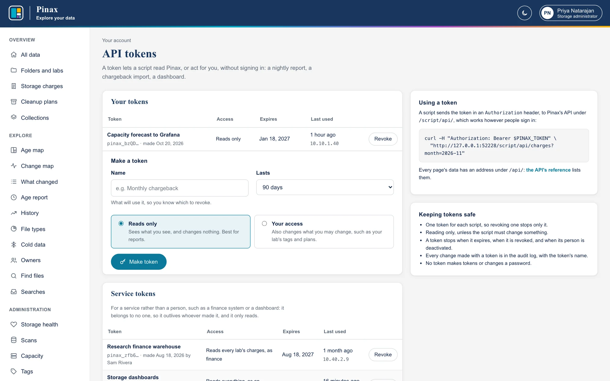

A script sends the token in an `Authorization` header to Pinax's API under `/script/api/`, which works however
your site signs people in (behind single sign-on, only a token gets through there). Every page's data has an
address under `/api/`, listed in the API's reference at `/api/docs`; put `/script` in front of it. For example,
what your labs are charged this month:

```bash
curl -H "Authorization: Bearer $PINAX_TOKEN" "https://pinax.example.org/script/api/charges"
```

And a script that downloads last month's chargeback statement, the CSV that *Chargeback* downloads, for someone
with the finance or auditor role, or for a service token that reads as finance
([Service tokens](ADMINISTRATION.md#api-tokens)). It uses only Python's standard library:

```python
#!/usr/bin/env python3
"""Download last month's chargeback statement from Pinax: pinax-charges-YYYY-MM.csv."""
import datetime
import os
import sys
import urllib.error
import urllib.request

PINAX = os.environ.get("PINAX_URL", "https://pinax.example.org")
TOKEN = os.environ["PINAX_TOKEN"]  # from the environment or a secrets store, never in the script

month = (datetime.date.today().replace(day=1) - datetime.timedelta(days=1)).strftime("%Y-%m")  # over, so final
request = urllib.request.Request(f"{PINAX}/script/api/admin/costs/charges?month={month}&fmt=csv",
                                 headers={"Authorization": f"Bearer {TOKEN}"})
try:
    with urllib.request.urlopen(request, timeout=300) as response:
        statement = response.read()
except urllib.error.HTTPError as e:
    sys.exit(f"Pinax answered {e.code}: {e.read().decode(errors='replace')}")
with open(f"pinax-charges-{month}.csv", "wb") as out:
    out.write(statement)
print(f"Saved pinax-charges-{month}.csv")
```
